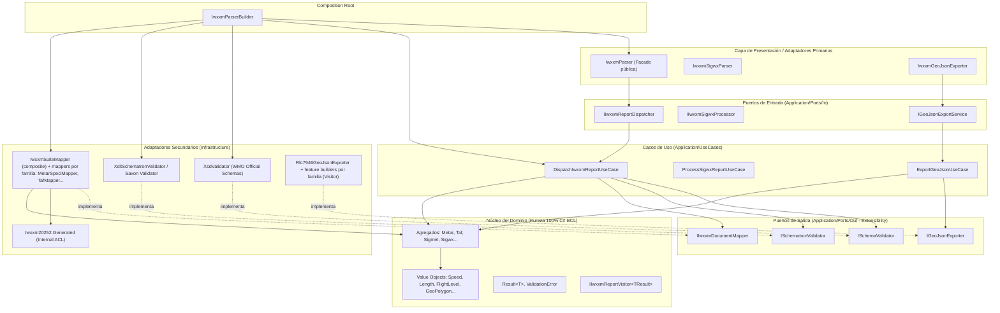

# Auditoría Arquitectónica y Catálogo de Deuda Técnica: `Iwxxm.Net`

**Versión del documento**: 1.1 (priorización DDD / Clean Code, sección 7)  
**Fecha**: 2026-10-29  
**Estado del repositorio**: Commit `5bc5a6d` (Merge PR #1, post-adopción de esquemas oficiales OMM)  
**Autor**: Arquitectura de Software  

---

## 1. Decisiones Estratégicas de Diseño Acordadas

A partir de las respuestas de diseño del usuario, se establecen los siguientes principios rectores:

1. **Lenguaje Ubicuo (DDD) basado en Acrónimos Habituales**:
   - Se abandona la terminología artificial o excesivamente verbosa en el Dominio (`AerodromeWeatherReport`, `SignificantWeatherReport`, `VolcanicAshAdvisoryReport`).
   - Se adopta la nomenclatura operativa estándar en la industria aeronáutica y entre despachadores/pilotos: `Metar`, `Speci`, `Taf`, `Sigwx`, `Sigmet`, `Airmet`, `Vona`, `Qvaci`, `Vaa`, `Tca`, `SpaceWx`, y `MeteorologicalBulletin`.
   - Se eliminan sufijos superfluos en Value Objects (`SurfaceWind` en lugar de `SurfaceWindInfo`, `RunwayVisualRange` en lugar de `RunwayVisualRangeInfo`, etc.).

2. **Descomposición de *God Classes* (Clean Code: SRP & OCP)**:
   - Se aprueba la partición y modularización de `IwxxmSuiteMapper` (>1350 líneas) y `Rfc7946GeoJsonExporter` (>980 líneas).
   - Se sustituye el *type-switching* en tiempo de ejecución por abstracciones desacopladas (patrón *Visitor* o *Strategy Registry*).

3. **Asincronía en Puertos**:
   - Se mantiene la API síncrona en la versión actual (1.0). No se introduce `ValueTask` / `Task` prematuramente para no sobrecargar la complejidad de la biblioteca mientras se afianzan los cimientos del dominio.

4. **Regla de Ejecución**:
   - **Fase de Análisis y Documentación**: No se implementarán cambios en el código productivo (`src/`) hasta que este documento de deuda y diseño esté plenamente alineado y aprobado.

---

## 2. Calibración Pragmática: Especificación IWXXM 2025-2 frente a Principios de Diseño

Un aspecto arquitectónico fundamental es comprender la relación entre la versión del estándar externo (OACI/OMM IWXXM 2025-2) y la necesidad de evolucionar el software:

### 2.1 ¿Por qué una especificación "congelada" sigue requiriendo cambios en `IwxxmSuiteMapper`?
La especificación oficial 2025-2 está fijada por la OACI, pero **su implementación en software no es estática**:
1. **Fidelidad y completitud**: Ciertos elementos del estándar 2025-2 actualmente se descartan o mapean de forma simplificada (ej. geometrías `gml:CircleByCenterPoint` para radios de seguridad en avisos de ciclones tropicales o referencias cruzadas `xlink:href="#id"`). Corregir y completar estas capacidades en 2025-2 exige modificar los mappers sin que cambie la versión de la OACI.
2. **Cobertura incremental de campos opcionales**: Los centros emisores de distintos países (WAFC Londres, Washington, centros nacionales) emiten combinaciones no exploradas de campos opcionales (`nillable`, extensiones) que requieren ampliaciones de soporte.
3. **Optimización de memoria y concurrencia**: Ajustar asignaciones de memoria o parsing en streams de alto rendimiento implica refactorizar el código de extracción de reportes específicos.

### 2.2 Calibración de OCP (Open/Closed Principle) vs YAGNI
Dado que IWXXM 2025-2 define un **catálogo cerrado y finito** de 13 tipos de reportes más el sobre SWIM `collect`:
- **Evitar la sobreingeniería (YAGNI)**: Sería un error diseñar un complejo framework dinámico de inyección de dependencias o plugins reflectivos externos para "admitir reportes desconocidos", puesto que no surgirán nuevos tipos de reportes dentro de la versión 2025-2.
- **OCP Pragmático**: El desacoplamiento en exporters y dispatchers debe resolverse de forma limpia y directa mediante tipado estático (patrón **Visitor** en el dominio o un registro directo), sin incurrir en abstracciones innecesarias.

### 2.3 SRP como garantía de Contención de Daños (*Blast Radius*)
El valor de modularizar `IwxxmSuiteMapper` reside en el principio de responsabilidad única (SRP) y en la **seguridad del software aeronáutico**:
- Si se corrige o mejora la decodificación de cenizas volcánicas (`Qvaci`), no se debe tocar, arriesgar ni recompilar el fichero donde reside la lógica crítica de vientos de aterrizaje de aeródromo (`Metar`).
- La modularidad aísla el radio de impacto de regresiones, facilita tests unitarios finos y evita conflictos de fusión en Git entre colaboradores.

### 2.4 Perspectiva Multiversión en Redes SWIM / AMHS
En el mundo real aeronáutico, **las versiones de IWXXM coexisten durante años**. En centros de control aéreo conviven mensajes en IWXXM 2021-2, 2023-1 y 2025-2:
- La Arquitectura Hexagonal y DDD garantizan que el **Dominio Canónico** (`Metar`, `Taf`, `Sigmet`) sea perenne e independiente del XML.
- Al separar `IwxxmSuiteMapper` en mappers específicos, dar soporte en el futuro a una versión alternativa de IWXXM (o la venidera 2026-x) consiste únicamente en añadir adaptadores en `Infrastructure`, sin alterar el núcleo de la aplicación.

---

## 3. Mapa Arquitectónico Objetivo (Hexagonal / Ports & Adapters)



---

## 4. Catálogo Exhaustivo de Deuda Técnica (Clasificado)

### 4.1 Deuda en Diseño Guiado por el Dominio (DDD)

| Código | Gravedad | Componente | Descripción del Problema | Razón y Solución Arquitectónica |
| :--- | :--- | :--- | :--- | :--- |
| **DDD-01** | **Alta** | `Domain/Aggregates` | **Alineación con el Lenguaje Ubicuo Operativo (Acrónimos)**:<br>`AerodromeWeatherReport` agrupa confusamente METAR y SPECI bajo un nombre inventado; `SignificantWeatherReport` es un término impreciso para un WAFS Forecast; sufijos redundantes `...AdvisoryReport`. | Renombrar y estructurar agregados a sus términos reales de aviación: `Metar`, `Speci`, `Taf`, `Sigwx`, `Sigmet`, `Airmet`, `Vona`, `Qvaci`, `Vaa`, `Tca`, `SpaceWx`. |
| **DDD-02** | **Media** | `Domain/Aggregates/AerodromeReports.cs` | **Sufijos artificiales `*Info` en Value Objects**:<br>`SurfaceWindInfo`, `RunwayVisualRangeInfo`, `AerodromeCloudLayerInfo`, `AerodromeForecastGroupInfo`. En cambio, en en-route se usan `Cloud`, `Turbulence`. | Normalizar: eliminar el sufijo `Info`. Nombres limpios: `SurfaceWind`, `RunwayVisualRange`, `CloudLayer`, `ForecastGroup`. |
| **DDD-03** | **Alta** | `Domain/Common`<br>`Aggregates` | **Primitive Obsession en Metadatos Operativos**:<br>`reportStatus` y `permissibleUsage` son tratados como `string` plano con valores mágicos (`"NORMAL"`, `"OPERATIONAL"`). | Introducir tipos del dominio: `enum ReportStatus { Normal, Correction, Amendment }` y `enum PermissibleUsage { Operational, NonOperational }`. Eliminar defaulting implícito que pueda convertir mensajes `TEST` en `OPERATIONAL`. |
| **DDD-04** | **Media** | `Domain/Aggregates`<br>`IIwxxmReport` | **Contrato `IIwxxmReport` forzado para Bulletins**:<br>`MeteorologicalBulletin` (un contenedor de transporte SWIM) se ve obligado a exponer `TranslationFailedTac` (siempre `null`), `PermissibleUsage`, etc. | Segregar interfaces: `IMeteorologicalReport` (reporte con estado/uso) e `IBulletinEnvelope` (sobre que agrupa colección de reportes). |
| **DDD-05** | **Media** | `Domain/Aggregates` | **Inconsistencia de Invariantes en Fábricas `Create(...)`**:<br>`Sigwx` valida fuertemente fechas y niveles verticales. `Metar` y `Sigmet` no validan coherencia temporal en el método `Create`, permitiendo la construcción de estados inválidos en el dominio si no pasan por Schematron. | Homogeneizar las invariantes mínimas físicas en todos los agregados del dominio (`ValidUntil > ValidFrom`, coherencia básica de timestamps). |
| **DDD-06** | **Alta** | `Domain/ValueObjects` | **Violación del Contrato de Igualdad en `GeoCoordinate` y `GeoPolygon`**:<br>`GeoCoordinate.Equals` usa tolerancia `1e-7` (`GeoCoordinate.cs:58`), pero `GetHashCode` redondea a 7 decimales (`:66`): `10.00000004` y `10.00000006` son iguales y tienen hash distinto. La igualdad con tolerancia además no es transitiva. `GeoPolygon.Equals` compara los anillos interiores solo por cantidad (`GeoPolygon.cs:96`). | Cuantizar una sola vez al construir (almacenar el valor redondeado) y comparar de forma exacta; comparar el contenido de los anillos interiores. |
| **DDD-07** | **Crítica** | `Domain/Aggregates`<br>`Infrastructure/Mapping` | **Valores inventados por defecto (modelo que miente)**:<br>41 puntos del código sustituyen datos ausentes por valores ficticios: `issueTime` → `DateTimeOffset.MinValue`, validez `?? issueTime`, `"NORMAL"` / `"OPERATIONAL"`, densidad `0.0`, volcán `"UNKNOWN"` (TECHNICAL_DEBT AUD-H5). | Un dato ausente debe ser explícito (`null` o error de mapeo), nunca un valor plausible. En particular, un mensaje sin `permissibleUsage` nunca debe convertirse en `OPERATIONAL`. |
| **DDD-08** | **Alta** | `Domain/ValueObjects/FlightLevel.cs` | **Modelo vertical con pérdida de información**:<br>`FlightLevel` es un único `int` sin referencia vertical (SFC / MSL / STD) ni motivo de nulidad; "15 km AMSL" se convierte en FL492 y "SFC/3000FT" no se distingue de FL030 (AUD-M7). | Introducir un Value Object `VerticalLimit` (valor, unidad, referencia, `nilReason`) y dejar el nivel de vuelo como vista derivada solo cuando la referencia sea STD. |
| **DDD-09** | **Media** | `Domain/Aggregates` | **Value Objects con igualdad por referencia**:<br>`SurfaceWindInfo`, `RunwayVisualRangeInfo`, `AerodromeCloudLayerInfo`, `AerodromeForecastGroupInfo`, `EnRoutePhenomenonVolume` y `JetStreamCorePoint` son clases sin `Equals` / `GetHashCode`: dos vientos idénticos no son iguales (AUD-L10). | Igualdad estructural (`IEquatable<T>`) o tipos `readonly struct`, coherente con `Speed` / `Length`. |
| **DDD-10** | **Media** | `Domain/Aggregates` | **URIs de Linked Data como `string` en el Dominio**:<br>Los códigos de las codelists WMO (`amountUri`, `presentWeather`, `cloudType`) se guardan como URI textual. El Dominio conoce un detalle de transporte (RDF / `codes.wmo.int`). | Traducir en la capa anticorrupción a tipos del Dominio (enums o Value Objects) conservando el código original como dato informativo. |

---

### 4.2 Deuda en Clean Code y Principios SOLID

| Código | Gravedad | Componente | Descripción del Problema | Razón y Solución Arquitectónica |
| :--- | :--- | :--- | :--- | :--- |
| **CLN-01** | **Crítica** | `Infrastructure/Mapping`<br>`IwxxmSuiteMapper.cs` | **God Class (Violación de SRP)**:<br>1359 líneas y 34 métodos estáticos en una sola clase que sabe cómo deserializar y mapear los 12 tipos de reportes de toda la suite OACI/OMM. | Descomponer en mappers especializados por agregado: `MetarReportMapper`, `TafReportMapper`, `SigmetReportMapper`, `AdvisoryReportMapper`, etc., coordinados por un `IwxxmCompositeDocumentMapper`. |
| **CLN-02** | **Alta** | `Infrastructure/GeoJson`<br>`Rfc7946GeoJsonExporter.cs` | **God Class y Violación de OCP (Open/Closed)**:<br>984 líneas con un gigantesco `switch (report)` que inspecciona tipos en runtime (`case AerodromeWeatherReport: ...`). Agregar un reporte nuevo requiere modificar esta clase. | Implementar el patrón **Visitor** en `IIwxxmReport` (`TResult Accept<TResult>(IIwxxmReportVisitor<TResult> visitor)`) o un registro desacoplado de proveedores de features GeoJSON (`IGeoJsonFeatureExtractor<TReport>`). |
| **CLN-03** | **Media** | `Domain/Aggregates` | **Múltiples Clases Públicas por Archivo**:<br>`AerodromeReports.cs` tiene 6 clases públicas. `VolcanicAndSpaceReports.cs` tiene 8 clases públicas. | Extraer cada clase y Value Object a su propio fichero `.cs` individual (Regla de oro de Clean Code para navegabilidad y control de cambios en Git). |
| **CLN-04** | **Media** | `Presentation/IwxxmParser` | **Excepciones de I/O que escapan a `Result<T>`**:<br>`FileStream` y operaciones de archivo en `ProcessFile(...)` pueden lanzar excepciones no controladas (`UnauthorizedAccessException`, `IOException`) violando la promesa de una API funcional libre de excepciones no capturadas. | Envolver las operaciones I/O en bloques `try/catch` seguros retornando códigos de error estructurados (`FILE-READ-ERROR`, `ACCESS-DENIED`). |
| **CLN-05** | **Alta** | `Infrastructure/Mapping`<br>`SigwxMapper.cs` | **Segunda God Class omitida en el plan**:<br>`SigwxMapper.cs` tiene 1006 líneas (más que `Rfc7946GeoJsonExporter`) y no figura en la Fase 3. | Incluirla en la descomposición: extractores por familia de fenómeno WAFS (nubes, turbulencia, engelamiento, jet stream, tropopausa, fenómenos puntuales). |
| **CLN-06** | **Baja** | `Infrastructure/Generated`<br>`GmlCoordinateTokenizer.cs` | **Comentarios que no dicen la verdad**:<br>la cabecera de `Iwxxm20252.Generated.cs` afirma que es código generado por `xscgen` (es manual) y el tokenizer se describe como *zero-allocation* (asigna en `netstandard2.0`) (AUD-M16, AUD-L1). | Corregir los comentarios o hacerlos ciertos. Un comentario falso es peor que ningún comentario. |
| **CLN-07** | **Baja** | `Domain/ValueObjects/WmoCodes.cs` | **Duplicación y números mágicos**:<br>los cuatro `Resolve*` repiten el mismo bloque, con una guarda `>= 0` y un límite `token.Length <= 3` sin explicar. | Extraer un helper genérico y documentar la razón de cada constante. |

---

### 4.3 Deuda en Arquitectura Hexagonal y Puertos

| Código | Gravedad | Componente | Descripción del Problema | Razón y Solución Arquitectónica |
| :--- | :--- | :--- | :--- | :--- |
| **HEX-01** | **Media** | `Application/Ports/Out`<br>`IIwxxmDocumentMapper` | **Fuga de Abstracción de I/O (`Stream`) en Puerto**:<br>El puerto de mapeo de documentos recibe un `Stream` binario. El mapper de infraestructura vuelve a instanciar `XmlReaderSettings` para protegerse de ataques XML DoS. | El caso de uso debe encargarse de la sanitización/lectura y entregar al puerto de mapeo un contexto neutral o un lector controlado, manteniendo la I/O en la frontera. |
| **HEX-02** | **Baja** | `Presentation/IwxxmParser` | **Duplicidad de Contrato en Fachada**:<br>`IwxxmParser` implementa `IIwxxmReportDispatcher`, actuando de envoltorio que simplemente delega cada método en `_dispatcher`. | Mantener la fachada como el punto de entrada amigable (DX), pero diferenciar claramente los métodos de conveniencia de la interfaz pura del caso de uso. |

---

## 5. Matriz de Mapeo del Lenguaje Ubicuo (Nomenclatura Propuesta)

| Modelo Actual | Tipo DDD | Nombre Propuesto (Acrónimo) | Justificación Operativa |
| :--- | :--- | :--- | :--- |
| `AerodromeWeatherReport` (tipo METAR) | Agregado | `MetarReport` (o `Metar`) | Identificación directa con el informe rutinario de aeródromo. |
| `AerodromeWeatherReport` (tipo SPECI) | Agregado | `SpeciReport` (o `Speci`) | Informe especial de aeródromo por cambio significativo. |
| `TafReport` | Agregado | `Taf` (o `TafReport`) | Terminal Aerodrome Forecast. |
| `SignificantWeatherReport` | Agregado | `Sigwx` (o `SigwxReport`) | Pronóstico WAFS Significant Weather. |
| `SigmetReport` | Agregado | `Sigmet` (o `SigmetReport`) | Fenómenos meteorológicos en ruta que afectan a la seguridad. |
| `AirmetReport` | Agregado | `Airmet` (o `AirmetReport`) | Fenómenos meteorológicos para vuelos a baja cota. |
| `VolcanicAshAdvisoryReport` | Agregado | `Vaa` (o `VaaReport`) | Volcanic Ash Advisory. |
| `TropicalCycloneAdvisoryReport` | Agregado | `Tca` (o `TcaReport`) | Tropical Cyclone Advisory. |
| `SpaceWeatherAdvisoryReport` | Agregado | `SpaceWx` (o `SpaceWxReport`) | Space Weather Advisory. |
| `VonaReport` | Agregado | `Vona` | Volcano Observatory Notice for Aviation. |
| `QvaciReport` | Agregado | `Qvaci` | Quantitative Volcanic Ash Concentration. |
| `MeteorologicalBulletin` | Agregado / Envelope | `MeteorologicalBulletin` | Contenedor SWIM / COLLECT de boletines. |
| `SurfaceWindInfo` | Value Object | `SurfaceWind` | Sin sufijo `Info`. Viento en superficie. |
| `RunwayVisualRangeInfo` | Value Object | `RunwayVisualRange` | Sin sufijo `Info`. RVR de pista. |
| `AerodromeCloudLayerInfo` | Value Object | `AerodromeCloudLayer` | Sin sufijo `Info`. Capa de nubes de aeródromo. |
| `AerodromeForecastGroupInfo` | Value Object | `AerodromeForecastGroup` | Sin sufijo `Info`. Grupo de cambio (TEMPO, BECMG). |

---

## 6. Plan Maestro de Refactorización (Fases Futuras)

> [!IMPORTANT]
> Ninguna de estas fases se ejecutará hasta que concluya formalmente el análisis y la aprobación de este documento.

1. **Fase 1: Reestructuración de Archivos y Value Objects (Clean Code básico)**:
   - Separar archivos con múltiples clases públicas en un tipo por archivo.
   - Eliminar los sufijos `*Info` en los VOs de aeródromo.
   - Corregir el contrato de igualdad / hash code en `GeoCoordinate`.

2. **Fase 2: Adopción del Lenguaje Ubicuo (Acrónimos en Agregados)**:
   - Dividir `AerodromeWeatherReport` en `Metar` y `Speci`.
   - Renombrar `SignificantWeatherReport` a `Sigwx`.
   - Introducir `ReportStatus` y `PermissibleUsage` como Enums del dominio.
   - Actualizar las pruebas de arquitectura IL para reflejar los nuevos tipos en el catálogo.

3. **Fase 3: Descomposición de God Classes (Mappers y Exporters)**:
   - Crear mappers individuales por familia de reporte dentro de `Infrastructure/Mapping/Reports/`.
   - Implementar el patrón Visitor (`IIwxxmReportVisitor<TResult>`) en `IIwxxmReport` para desacoplar el exportador GeoJSON de forma directa y pragmática (sin frameworks de plugins innecesarios).
   - Descomponer `Rfc7946GeoJsonExporter` en feature extractors específicos por agregado.

4. **Fase 4: Blindaje de Fachada y Pruebas de Integración**:
   - Capturar excepciones I/O en `IwxxmParser.ProcessFile(...)`.
   - Validar suite de 389 tests y verificar el 100% de cumplimiento en `HexagonalArchitectureTests.cs`.

---

## 7. Priorización de la Deuda DDD y Clean Code

Esta sección consolida los puntos de DDD y Clean Code de este documento y de [`TECHNICAL_DEBT.md`](../TECHNICAL_DEBT.md), verificados contra el código del commit `e11e449`, estima su alcance y los ordena de mayor a menor criticidad.

### 7.1 Criterios

**Criticidad** — se mide por el daño que el defecto puede causar, no por lo feo que sea el código:

| Nivel | Definición | Por qué va antes |
| :--- | :--- | :--- |
| **Crítica** | Puede producir información meteorológica falsa o engañosa. | En aviación, un dato erróneo que parece correcto es más peligroso que un error visible. |
| **Alta** | Rompe un contrato que el consumidor da por garantizado (igualdad, ausencia de excepciones, invariantes) o pierde información del estándar. | El consumidor no puede defenderse de lo que la API promete y no cumple. |
| **Media** | Aumenta el coste de mantenimiento y el riesgo de regresión (SRP, OCP, igualdad de VOs auxiliares). | No produce datos erróneos hoy, pero facilita que aparezcan mañana. |
| **Baja** | Legibilidad, nomenclatura y organización. | Importa, pero un nombre mejorable no derriba ningún avión. |

**Alcance** — esfuerzo y superficie del cambio:

| Talla | Ficheros | Líneas aprox. |
| :--- | :--- | :--- |
| **S** | ≤ 5 | < 300 |
| **M** | 5 – 15 | 300 – 1.000 |
| **L** | > 15 | > 1.000 o cambio transversal |

La columna **Rompe API** indica si el cambio obliga a modificar código de los consumidores del paquete NuGet.

### 7.2 Ranking consolidado

| # | Código | Criticidad | Alcance | Rompe API | Resumen | Referencias | Estado |
| :--- | :--- | :--- | :--- | :--- | :--- | :--- | :--- |
| 1 | **DDD-07** | Crítica | M (~10 ficheros, 41 puntos) | Sí (campos pasan a nullable) | Eliminar valores inventados por defecto | AUD-H5 | Implementado (Unreleased) |
| 2 | **DDD-03** | Crítica | M | Sí | `ReportStatus` / `PermissibleUsage` tipados y sin *defaulting* | AUD-M8, AUD-U8 | Implementado (Unreleased); segregación de interfaces pendiente (DDD-04) |
| 3 | **DDD-08** | Alta | M–L | Sí | `VerticalLimit` con referencia vertical | AUD-M7, AUD-U7 | Implementado (Unreleased) |
| 4 | **DDD-06** | Alta | S (2 ficheros) | No (cambia comportamiento) | Contrato `Equals` / `GetHashCode` de `GeoCoordinate` y `GeoPolygon` | AUD-M6 | Implementado (Unreleased) |
| 5 | **CLN-04** | Alta | S (1–2 ficheros) | No | Excepciones de I/O fuera de `Result<T>` | AUD-M4 | Implementado (Unreleased) |
| 6 | **DDD-05** | Alta | M | No (nuevos errores de creación) | Invariantes homogéneas en las fábricas `Create` | AUD-L10 | Implementado (Unreleased) |
| 7 | **CLN-01** | Media | L (~1.360 líneas) | No | Descomponer `IwxxmSuiteMapper` | AUD-A1 §8.2 | Implementado (Unreleased) |
| 8 | **CLN-05** | Media | L (~1.000 líneas) | No | Descomponer `SigwxMapper` | AUD-A1 §8.2 | Implementado (Unreleased) |
| 9 | **CLN-02** | Media | M (~980 líneas) | Sí (Visitor y jerarquía cerrada `IwxxmReport`) | Visitor y descomposición del exportador GeoJSON | AUD-A1 §8.2 | Implementado (Unreleased) |
| 10 | **DDD-09** | Media | S–M (6 tipos) | No (cambia comportamiento) | Igualdad estructural en VOs auxiliares | AUD-L10 | Pendiente |
| 11 | **DDD-04** | Media | S–M | Sí | Segregar `IMeteorologicalReport` / `IBulletinEnvelope` | AUD-M8 | Pendiente |
| 12 | **DDD-10** | Media | M | Sí | URIs de codelists traducidas en la ACL | AUD-A1 §8.2 | Pendiente |
| 13 | **DDD-01** | Baja | L (transversal) | Sí | Nombres operativos (`Metar`, `Speci`, `Sigwx`, …) | AUD-A1 §8.1 | Pendiente |
| 14 | **DDD-02** | Baja | S | Sí | Eliminar el sufijo `Info` | AUD-A1 §8.1 | Pendiente |
| 15 | **CLN-03** | Baja | S (mecánico, ~5 ficheros → ~25) | No | Un tipo público por fichero | AUD-A1 §8.2 | Pendiente |
| 16 | **CLN-06** | Baja | S | No | Comentarios veraces | AUD-M16, AUD-L1 | Pendiente |
| 17 | **CLN-07** | Baja | S | No | Duplicación y números mágicos en `WmoCodes` | — | Pendiente |

> **Estado (Unreleased)**: los puntos 1 a 9 están implementados. Decisiones principales: (1) un dato obligatorio según el XSD oficial que falta es un error de mapeo; un dato opcional, nulo o dado solo por `xlink:href` (no resuelto) es `null`; (2) `ReportStatus`, `PermissibleUsage` y `PermissibleUsageReason` son enums y los metadatos de `MeteorologicalBulletin` se derivan de sus informes (hora de emisión más temprana; no operacional si algún informe lo es); (3) `VerticalLimit` conserva valor, unidad, referencia vertical, valor especial y `nilReason`, y `FlightLevel` es solo una vista derivada para STD; (4) `GeoCoordinate` se cuantiza a 1e-7 grados al construirse y se compara de forma exacta; (5) los fallos de E/S y de adaptadores se devuelven como errores tipados (`FILE-NOT-FOUND`, `ACCESS-DENIED`, `FILE-READ-ERROR`, ...); (6) las fábricas `Create` aplican invariantes físicas homogéneas: periodos ordenados, desfase UTC nulo, dirección en [0, 360], magnitudes no negativas, metadatos definidos y unidad ATS obligatoria en AIRMET. Las reglas de negocio del Schematron oficial no se duplican. (7–9) Las tres *God Classes* se descompusieron sin cambio de comportamiento: `IwxxmSuiteMapper` es un *composite* que carga el documento y despacha por el QName raíz mediante un registro estático (`IwxxmReportMapperRegistry`) hacia un mapper por familia (`Infrastructure/Mapping/Reports`) con lectores compartidos en `Infrastructure/Mapping/Xml`; `SigwxMapper` coordina `WafsForecastMapper`, `CompactSigwxReportMapper` y un extractor por familia de fenómeno WAFS (`Infrastructure/Mapping/Sigwx`); `Rfc7946GeoJsonExporter` usa el Visitor del dominio (`IIwxxmReportVisitor<TResult>`, `IwxxmReport.Accept<TResult>`) con un *feature builder* por familia y escritores separados. Los *characterization tests* (`tests/Iwxxm.Net.Tests/GoldenMaster`) se generaron antes del refactor sobre los 29 ejemplos oficiales y las dos muestras SIGWX (modelo de dominio completo y GeoJSON) y no cambiaron después. `IwxxmReportType` se conserva por compatibilidad como clasificación descriptiva; las comprobaciones `is MeteorologicalBulletin` / `is TReport` que permanecen son refinamientos de un único tipo, no despacho por tipo de informe.

> **Cambio respecto a la versión 1.0**: DDD-01 bajó de *Alta* a *Baja* y CLN-01 de *Crítica* a *Media*. No porque dejen de ser importantes, sino porque no generan datos erróneos: son deuda de mantenimiento. En cambio, los valores inventados (DDD-07) y el modelo vertical (DDD-08), que no figuraban, sí pueden mostrar al usuario información falsa con apariencia de válida.

### 7.3 Explicación de cada punto prioritario

#### 1. DDD-07 — Un modelo de dominio nunca debe mentir

**El problema.** Cuando falta un dato, el mapper inventa uno plausible. Ejemplos reales del código:

```csharp
// Infrastructure/Mapping/IwxxmSuiteMapper.cs:221 — "año 0001" si falta issueTime
DateTimeOffset issueTime = ParseTimeInstantProperty(root.Element(IwxxmNs + "issueTime")) ?? DateTimeOffset.MinValue;

// IwxxmSuiteMapper.cs:483-484 — validez de 0 minutos si falta el periodo
validFrom ?? issueTime,
validUntil ?? issueTime,
```

```csharp
// Domain/Aggregates/AerodromeReports.cs:240-241 (patrón repetido en todos los Create)
string.IsNullOrWhiteSpace(reportStatus) ? "NORMAL" : reportStatus!,
string.IsNullOrWhiteSpace(permissibleUsage) ? "OPERATIONAL" : permissibleUsage!,
```

**Por qué es crítico.** El consumidor no puede distinguir "el informe dice NORMAL" de "el informe no decía nada". El caso más grave: un mensaje de ejercicio o prueba con el atributo ausente se presenta como **operacional**.

**El principio.** En DDD, el modelo debe representar fielmente el conocimiento disponible. "No lo sé" es un estado legítimo y debe ser explícito: `null`, un `Option`, o un error de mapeo si el estándar exige el dato (`reportStatus` y `permissibleUsage` son `use="required"` en `common.xsd`).

**Alcance.** ~10 ficheros. Rompe API porque varias propiedades pasan a ser *nullable*. Se aborda junto con DDD-03.

#### 2. DDD-03 — *Primitive Obsession* en los metadatos operativos

**El problema.** `IIwxxmReport.ReportStatus` y `PermissibleUsage` son `string` (`IIwxxmReport.cs:51,56`). El compilador acepta `"NORMALL"` o `"operational"`.

**La solución.** Enums del dominio con el conjunto cerrado del estándar:

```csharp
public enum ReportStatus { Normal, Amendment, Correction }
public enum PermissibleUsage { Operational, NonOperational }
public enum PermissibleUsageReason { Test, Exercise }
```

El mapper traduce el texto XML; un valor desconocido es un error de mapeo, no un valor por defecto.

#### 3. DDD-08 — `VerticalLimit`: no todas las alturas son niveles de vuelo

**El problema.** Un nivel de vuelo (FL) es una altitud de presión respecto a la referencia estándar (STD, 1013,25 hPa). Una altura sobre el nivel del mar (MSL) o sobre el terreno (SFC) **no** es un nivel de vuelo. El modelo actual reduce todo a `FlightLevel(int)`, por lo que "15 km AMSL" acaba como FL492.

**La solución.** Un Value Object que conserve lo que dice el documento:

```csharp
public readonly struct VerticalLimit
{
    public double? Value { get; }            // null cuando es SFC / UNL / desconocido
    public LengthUnit? Unit { get; }
    public VerticalReference Reference { get; } // Sfc, Msl, Std
    public string? NilReason { get; }
    public FlightLevel? AsFlightLevel();      // solo cuando Reference == Std
}
```

**Alcance.** M–L: SIGMET, AIRMET, VONA, VAA, SIGWX y GeoJSON.

#### 4. DDD-06 — El contrato `Equals` / `GetHashCode`

**La regla.** Si `a.Equals(b)` es verdadero, entonces `a.GetHashCode() == b.GetHashCode()` **debe** ser verdadero. `HashSet`, `Dictionary` y `Distinct()` dependen de ello.

**El problema.** `GeoCoordinate` compara con tolerancia pero calcula el hash con redondeo:

```csharp
Math.Abs(Lat - other.Lat) < 1e-7          // 10.00000004 ≈ 10.00000006 → iguales
Math.Round(Lat, 7).GetHashCode()          // 10.0000000 ≠ 10.0000001 → hash distinto
```

Resultado: dos coordenadas "iguales" pueden convivir en un `HashSet`. Además, la igualdad con tolerancia no es transitiva (a≈b y b≈c no implica a≈c), lo que viola otro requisito de `Equals`.

**La solución.** Cuantizar una vez en el constructor y comparar exactamente. En `GeoPolygon`, comparar también el contenido de los anillos interiores, no solo su número.

**Alcance.** S. Dos ficheros, sin cambio de firma.

#### 5. CLN-04 — Una API que promete no lanzar excepciones debe cumplirlo

`IwxxmParser.ProcessFile` abre un `FileStream` (`IwxxmParser.cs:198`) sin capturar `IOException` ni `UnauthorizedAccessException`. Si la API devuelve `Result<T>`, el consumidor no espera un `try/catch`. La solución es traducir esos fallos a errores tipados (`FILE-READ-ERROR`, `ACCESS-DENIED`).

#### 6. DDD-05 — Invariantes: un agregado inválido no debería poder existir

Solo `SignificantWeatherReport` comprueba `ValidUntil > ValidFrom`. Las fábricas de `Sigmet`, `Airmet`, `Taf` y las de aeródromo aceptan periodos invertidos. La regla del patrón *Always-Valid Domain Model* es que la fábrica `Create` sea la única puerta de entrada y garantice las invariantes físicas mínimas, sin depender de que el Schematron se haya ejecutado (el Schematron se puede desactivar con `WithoutSchematron()`).

#### 7–9. CLN-01, CLN-05, CLN-02 — Las God Classes

Las tres clases (`IwxxmSuiteMapper` 1358 líneas, `SigwxMapper` 1006, `Rfc7946GeoJsonExporter` 983) suman ~3.350 líneas con múltiples razones para cambiar. La sección 2.3 explica el valor: **contener el radio de impacto**.

**Requisito previo imprescindible: red de seguridad.** Antes de mover una sola línea, crear *characterization tests* (tests de caracterización o *golden master*): serializar el resultado completo del mapeo y del GeoJSON de los 29 ejemplos oficiales y compararlo byte a byte tras el refactor. Los tests actuales verifican propiedades concretas; un golden master detecta cualquier cambio de comportamiento accidental. Refactorizar sin esta red es cambiar el motor en pleno vuelo con el panel de instrumentos apagado.

**Sobre el Visitor (CLN-02).** Añadir `Accept<TResult>(IIwxxmReportVisitor<TResult>)` a `IIwxxmReport` convierte el `switch` en comprobación del compilador: si se añade un tipo de informe, todo visitor que no lo trate deja de compilar. Es OCP resuelto con tipado estático, coherente con la calibración YAGNI de la sección 2.2.

**Jerarquía cerrada (Unreleased).** La interfaz pública `IIwxxmReport` se sustituyó por la clase base abstracta pública `IwxxmReport` (`Iwxxm.Net.Reports`), cuyo constructor es `private protected`: ningún tipo fuera del ensamblado `Iwxxm.Net` puede derivar de ella. Los 11 agregados concretos (incluidos `MeteorologicalBulletin` y `SignificantWeatherReport`) derivan de la base y son `sealed`; los miembros de la antigua interfaz y `Accept<TResult>` son abstractos, por lo que el comportamiento no cambia. El motivo es la sección 2.2: IWXXM 2025-2 define un catálogo cerrado y finito de informes. Con una interfaz pública, un tercero podía implementar `IIwxxmReport` con un tipo que ningún visitor trata, y la garantía de exhaustividad del Visitor dejaba de ser cierta. Con la jerarquía cerrada, añadir un tipo de informe es siempre un cambio de la biblioteca, y el compilador obliga a actualizar `IIwxxmReportVisitor<TResult>` y todos sus visitors. `ClosedReportHierarchyTests` verifica por reflexión que la base no tiene constructores públicos ni protegidos, que todo subtipo está en `Iwxxm.Net` y es `sealed`, y que el visitor tiene exactamente una sobrecarga `Visit` por subtipo concreto. Es un cambio incompatible de API (renombrar referencias; las implementaciones externas dejan de ser posibles por diseño). Los *golden files* de GeoJSON no cambian; en los volcados de dominio de los tres boletines solo cambia el nombre del tipo genérico (`Result<IIwxxmReport>` → `Result<IwxxmReport>`).

#### 13. DDD-01 — Nomenclatura operativa: importante, pero no urgente

Renombrar no corrige ningún dato; por eso baja a *Baja* criticidad. Sin embargo, es el cambio que **más rompe la API**, de modo que conviene agruparlo con los demás cambios incompatibles (DDD-03, DDD-07, DDD-08) en **una única versión mayor**, en lugar de romper la API varias veces.

**Matiz sobre METAR / SPECI.** En IWXXM ambos comparten el mismo tipo (`MeteorologicalAerodromeObservationReportType`) y solo difieren en el elemento raíz y en el motivo de emisión. Dividirlos en dos clases independientes duplicaría código. La alternativa recomendada es una base común con dos especializaciones:

```csharp
public abstract class AerodromeObservation { /* contenido común */ }
public sealed class Metar : AerodromeObservation { }
public sealed class Speci : AerodromeObservation { }
```

Así el lenguaje ubicuo se respeta (`Metar`, `Speci`) sin duplicar la lógica.

### 7.4 Prioridad no es orden de ejecución

La criticidad dice **qué duele más**; el orden de ejecución dice **qué conviene hacer primero** para que el resto sea más barato y seguro. Se recomiendan cuatro oleadas:

| Oleada | Contenido | Motivo |
| :--- | :--- | :--- |
| **0. Habilitadores** (S, sin romper API) | CLN-03, CLN-06, CLN-07 y *characterization tests* de los 29 ejemplos | Cambios mecánicos y de bajo riesgo que facilitan las revisiones posteriores y crean la red de seguridad. |
| **1. Correcciones sin romper API** | DDD-06, CLN-04, DDD-09, DDD-05 | Corrigen contratos rotos sin obligar a los consumidores a cambiar código. Pueden publicarse en una versión menor. |
| **2. Versión mayor del Dominio** (rompe API, una sola vez) | DDD-07, DDD-03, DDD-08, DDD-04, DDD-10, DDD-01, DDD-02 | Todos los cambios incompatibles juntos, con una guía de migración en `CHANGELOG.md`. |
| **3. Descomposición estructural** | CLN-01, CLN-05, CLN-02 | Con el modelo ya estable, se descomponen los mappers y el exportador protegidos por los tests de caracterización. |

> Las oleadas 2 y 3 se pueden intercambiar si se prefiere descomponer antes de renombrar: un mapper pequeño es más fácil de adaptar al nuevo modelo. La condición no negociable es que los tests de caracterización existan antes de cualquiera de las dos.
