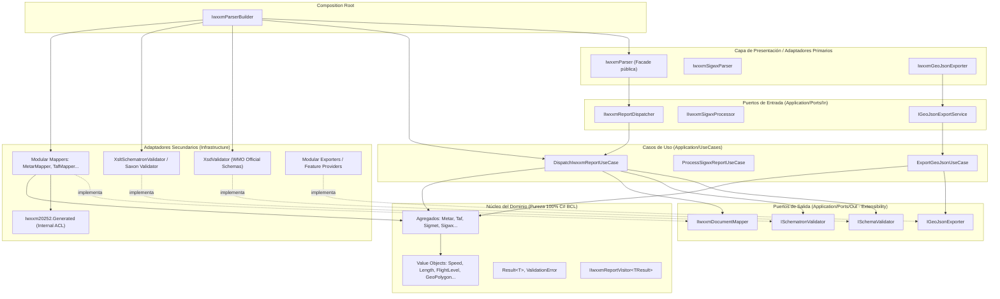

# Auditoría Arquitectónica y Catálogo de Deuda Técnica: `Iwxxm.Net`

**Versión del documento**: 1.0  
**Fecha**: 2026-10-29  
**Estado del repositorio**: Commit `5bc5a6d` (Merge PR #1, post-adopción de esquemas oficiales OMM)  
**Autor**: Arquitectura de Software  

---

## 1. Decisiones Estratégicas de Diseño Acordadas

A partir de las respuestas de diseño del usuario, se establecen los siguientes principios rectores:

1. **Lenguaje Ubicuo (DDD) basado en Acrónimos Habituales**:
   - Se abandona la terminología artificial o excesivamente verbosa en el Dominio (`AerodromeWeatherReport`, `SignificantWeatherReport`, `VolcanicAshAdvisoryReport`).
   - Se adopta la nomenclatura operativa estándar en la industria aeronáutica y entre despachadores/pilotos: `Metar`, `Speci`, `Taf`, `Sigwx`, `Sigmet`, `Airmet`, `Vona`, `Qvaci`, `Vaa`, `Tca`, `SpaceWx`, y `MeteorologicalBulletin`.
   - Se eliminan sufijos superfluos en Value Objects (`SurfaceWind` en lugar de `SurfaceWindInfo`, `RunwayVisualRange` en lugar de `RunwayVisualRangeInfo`, etc.).

2. **Descomposición de *God Classes* (Clean Code: SRP & OCP)**:
   - Se aprueba la partición y modularización de `IwxxmSuiteMapper` (>1350 líneas) y `Rfc7946GeoJsonExporter` (>980 líneas).
   - Se sustituye el *type-switching* en tiempo de ejecución por abstracciones desacopladas (patrón *Visitor* o *Strategy Registry*).

3. **Asincronía en Puertos**:
   - Se mantiene la API síncrona en la versión actual (1.0). No se introduce `ValueTask` / `Task` prematuramente para no sobrecargar la complejidad de la biblioteca mientras se afianzan los cimientos del dominio.

4. **Regla de Ejecución**:
   - **Fase de Análisis y Documentación**: No se implementarán cambios en el código productivo (`src/`) hasta que este documento de deuda y diseño esté plenamente alineado y aprobado.

---

## 2. Calibración Pragmática: Especificación IWXXM 2025-2 frente a Principios de Diseño

Un aspecto arquitectónico fundamental es comprender la relación entre la versión del estándar externo (OACI/OMM IWXXM 2025-2) y la necesidad de evolucionar el software:

### 2.1 ¿Por qué una especificación "congelada" sigue requiriendo cambios en `IwxxmSuiteMapper`?
La especificación oficial 2025-2 está fijada por la OACI, pero **su implementación en software no es estática**:
1. **Fidelidad y completitud**: Ciertos elementos del estándar 2025-2 actualmente se descartan o mapean de forma simplificada (ej. geometrías `gml:CircleByCenterPoint` para radios de seguridad en avisos de ciclones tropicales o referencias cruzadas `xlink:href="#id"`). Corregir y completar estas capacidades en 2025-2 exige modificar los mappers sin que cambie la versión de la OACI.
2. **Cobertura incremental de campos opcionales**: Los centros emisores de distintos países (WAFC Londres, Washington, centros nacionales) emiten combinaciones no exploradas de campos opcionales (`nillable`, extensiones) que requieren ampliaciones de soporte.
3. **Optimización de memoria y concurrencia**: Ajustar asignaciones de memoria o parsing en streams de alto rendimiento implica refactorizar el código de extracción de reportes específicos.

### 2.2 Calibración de OCP (Open/Closed Principle) vs YAGNI
Dado que IWXXM 2025-2 define un **catálogo cerrado y finito** de 13 tipos de reportes más el sobre SWIM `collect`:
- **Evitar la sobreingeniería (YAGNI)**: Sería un error diseñar un complejo framework dinámico de inyección de dependencias o plugins reflectivos externos para "admitir reportes desconocidos", puesto que no surgirán nuevos tipos de reportes dentro de la versión 2025-2.
- **OCP Pragmático**: El desacoplamiento en exporters y dispatchers debe resolverse de forma limpia y directa mediante tipado estático (patrón **Visitor** en el dominio o un registro directo), sin incurrir en abstracciones innecesarias.

### 2.3 SRP como garantía de Contención de Daños (*Blast Radius*)
El valor de modularizar `IwxxmSuiteMapper` reside en el principio de responsabilidad única (SRP) y en la **seguridad del software aeronáutico**:
- Si se corrige o mejora la decodificación de cenizas volcánicas (`Qvaci`), no se debe tocar, arriesgar ni recompilar el fichero donde reside la lógica crítica de vientos de aterrizaje de aeródromo (`Metar`).
- La modularidad aísla el radio de impacto de regresiones, facilita tests unitarios finos y evita conflictos de fusión en Git entre colaboradores.

### 2.4 Perspectiva Multiversión en Redes SWIM / AMHS
En el mundo real aeronáutico, **las versiones de IWXXM coexisten durante años**. En centros de control aéreo conviven mensajes en IWXXM 2021-2, 2023-1 y 2025-2:
- La Arquitectura Hexagonal y DDD garantizan que el **Dominio Canónico** (`Metar`, `Taf`, `Sigmet`) sea perenne e independiente del XML.
- Al separar `IwxxmSuiteMapper` en mappers específicos, dar soporte en el futuro a una versión alternativa de IWXXM (o la venidera 2026-x) consiste únicamente en añadir adaptadores en `Infrastructure`, sin alterar el núcleo de la aplicación.

---

## 3. Mapa Arquitectónico Objetivo (Hexagonal / Ports & Adapters)

---

## 4. Catálogo Exhaustivo de Deuda Técnica (Clasificado)

### 4.1 Deuda en Diseño Guiado por el Dominio (DDD)

| Código | Gravedad | Componente | Descripción del Problema | Razón y Solución Arquitectónica |
| :--- | :--- | :--- | :--- | :--- |
| **DDD-01** | **Alta** | `Domain/Aggregates` | **Alineación con el Lenguaje Ubicuo Operativo (Acrónimos)**: `AerodromeWeatherReport` agrupa confusamente METAR y SPECI bajo un nombre inventado; `SignificantWeatherReport` es un término impreciso para un WAFS Forecast; sufijos redundantes `...AdvisoryReport`. | Renombrar y estructurar agregados a sus términos reales de aviación: `Metar`, `Speci`, `Taf`, `Sigwx`, `Sigmet`, `Airmet`, `Vona`, `Qvaci`, `Vaa`, `Tca`, `SpaceWx`. |
| **DDD-02** | **Media** | `Domain/ValueObjects` | **Sufijos artificiales `*Info` en Value Objects**: `SurfaceWindInfo`, `RunwayVisualRangeInfo`, `AerodromeCloudLayerInfo`, `AerodromeForecastGroupInfo`. En cambio, en en-route se usan `Cloud`, `Turbulence`. | Normalizar: eliminar el sufijo `Info`. Nombres limpios: `SurfaceWind`, `RunwayVisualRange`, `CloudLayer`, `ForecastGroup`. |
| **DDD-03** | **Alta** | `Domain/Common` `Aggregates` | **Primitive Obsession en Metadatos Operativos**: `reportStatus` y `permissibleUsage` son tratados como `string` plano con valores mágicos (`"NORMAL"`, `"OPERATIONAL"`). | Introducir tipos del dominio: `enum ReportStatus { Normal, Correction, Amendment }` y `enum PermissibleUsage { Operational, NonOperational }`. Eliminar defaulting implícito que pueda convertir mensajes `TEST` en `OPERATIONAL`. |
| **DDD-04** | **Media** | `Domain/Aggregates` `IIwxxmReport` | **Contrato `IIwxxmReport` forzado para Bulletins**: `MeteorologicalBulletin` (un contenedor de transporte SWIM) se ve obligado a exponer `TranslationFailedTac` (siempre `null`), `PermissibleUsage`, etc. | Segregar interfaces: `IMeteorologicalReport` (reporte con estado/uso) e `IBulletinEnvelope` (sobre que agrupa colección de reportes). |
| **DDD-05** | **Media** | `Domain/Aggregates` | **Inconsistencia de Invariantes en Fábricas `Create(...)`**: `Sigwx` valida fuertemente fechas y niveles verticales. `Metar` y `Sigmet` no validan coherencia temporal en el método `Create`, permitiendo la construcción de estados inválidos en el dominio si no pasan por Schematron. | Homogeneizar las invariantes mínimas físicas en todos los agregados del dominio (`ValidUntil > ValidFrom`, coherencia básica de timestamps). |
| **DDD-06** | **Media** | `Domain/ValueObjects` | **Violación de Contrato de Igualdad en `GeoCoordinate`**: Usa tolerancia `1e-6` en `Equals`, pero `GetHashCode()` calcula el hash sobre el double exacto. | Cuantizar las coordenadas en el cálculo del hash o usar redondeo canónico (p.ej. 6 decimales) garantizando `A.Equals(B) => A.GetHashCode() == B.GetHashCode()`. |

---

### 4.2 Deuda en Clean Code y Principios SOLID

| Código | Gravedad | Componente | Descripción del Problema | Razón y Solución Arquitectónica |
| :--- | :--- | :--- | :--- | :--- |
| **CLN-01** | **Crítica** | `Infrastructure/Mapping` `IwxxmSuiteMapper.cs` | **God Class (Violación de SRP)**: 1359 líneas y 34 métodos estáticos en una sola clase que sabe cómo deserializar y mapear los 12 tipos de reportes de toda la suite OACI/OMM. | Descomponer en mappers especializados por agregado: `MetarReportMapper`, `TafReportMapper`, `SigmetReportMapper`, `AdvisoryReportMapper`, etc., coordinados por un `IwxxmCompositeDocumentMapper`. |
| **CLN-02** | **Alta** | `Infrastructure/GeoJson` `Rfc7946GeoJsonExporter.cs` | **God Class y Violación de OCP (Open/Closed)**: 984 líneas con un gigantesco `switch (report)` que inspecciona tipos en runtime (`case AerodromeWeatherReport: ...`). Agregar un reporte nuevo requiere modificar esta clase. | Implementar el patrón **Visitor** en `IIwxxmReport` (`TResult Accept<TResult>(IIwxxmReportVisitor<TResult> visitor)`) o un registro desacoplado de proveedores de features GeoJSON (`IGeoJsonFeatureExtractor<TReport>`). |
| **CLN-03** | **Media** | `Domain/Aggregates` | **Múltiples Clases Públicas por Archivo**: `AerodromeReports.cs` tiene 6 clases públicas. `VolcanicAndSpaceReports.cs` tiene 8 clases públicas. | Extraer cada clase y Value Object a su propio fichero `.cs` individual (Regla de oro de Clean Code para navegabilidad y control de cambios en Git). |
| **CLN-04** | **Media** | `Presentation/IwxxmParser` | **Excepciones de I/O que escapan a `Result<T>`**: `FileStream` y operaciones de archivo en `ProcessFile(...)` pueden lanzar excepciones no controladas (`UnauthorizedAccessException`, `IOException`) violando la promesa de una API funcional libre de excepciones no capturadas. | Envolver las operaciones I/O en bloques `try/catch` seguros retornando códigos de error estructurados (`FILE-READ-ERROR`, `ACCESS-DENIED`). |

---

### 4.3 Deuda en Arquitectura Hexagonal y Puertos

| Código | Gravedad | Componente | Descripción del Problema | Razón y Solución Arquitectónica |
| :--- | :--- | :--- | :--- | :--- |
| **HEX-01** | **Media** | `Application/Ports/Out` `IIwxxmDocumentMapper` | **Fuga de Abstracción de I/O (`Stream`) en Puerto**: El puerto de mapeo de documentos recibe un `Stream` binario. El mapper de infraestructura vuelve a instanciar `XmlReaderSettings` para protegerse de ataques XML DoS. | El caso de uso debe encargarse de la sanitización/lectura y entregar al puerto de mapeo un contexto neutral o un lector controlado, manteniendo la I/O en la frontera. |
| **HEX-02** | **Baja** | `Presentation/IwxxmParser` | **Duplicidad de Contrato en Fachada**: `IwxxmParser` implementa `IIwxxmReportDispatcher`, actuando de envoltorio que simplemente delega cada método en `_dispatcher`. | Mantener la fachada como el punto de entrada amigable (DX), pero diferenciar claramente los métodos de conveniencia de la interfaz pura del caso de uso. |

---

## 5. Matriz de Mapeo del Lenguaje Ubicuo (Nomenclatura Propuesta)

| Modelo Actual | Tipo DDD | Nombre Propuesto (Acrónimo) | Justificación Operativa |
| :--- | :--- | :--- | :--- |
| `AerodromeWeatherReport` (tipo METAR) | Agregado | `MetarReport` (o `Metar`) | Identificación directa con el informe rutinario de aeródromo. |
| `AerodromeWeatherReport` (tipo SPECI) | Agregado | `SpeciReport` (o `Speci`) | Informe especial de aeródromo por cambio significativo. |
| `TafReport` | Agregado | `Taf` (o `TafReport`) | Terminal Aerodrome Forecast. |
| `SignificantWeatherReport` | Agregado | `Sigwx` (o `SigwxReport`) | Pronóstico WAFS Significant Weather. |
| `SigmetReport` | Agregado | `Sigmet` (o `SigmetReport`) | Fenómenos meteorológicos en ruta que afectan a la seguridad. |
| `AirmetReport` | Agregado | `Airmet` (o `AirmetReport`) | Fenómenos meteorológicos para vuelos a baja cota. |
| `VolcanicAshAdvisoryReport` | Agregado | `Vaa` (o `VaaReport`) | Volcanic Ash Advisory. |
| `TropicalCycloneAdvisoryReport` | Agregado | `Tca` (o `TcaReport`) | Tropical Cyclone Advisory. |
| `SpaceWeatherAdvisoryReport` | Agregado | `SpaceWx` (o `SpaceWxReport`) | Space Weather Advisory. |
| `VonaReport` | Agregado | `Vona` | Volcano Observatory Notice for Aviation. |
| `QvaciReport` | Agregado | `Qvaci` | Quantitative Volcanic Ash Concentration. |
| `MeteorologicalBulletin` | Agregado / Envelope | `MeteorologicalBulletin` | Contenedor SWIM / COLLECT de boletines. |
| `SurfaceWindInfo` | Value Object | `SurfaceWind` | Sin sufijo `Info`. Viento en superficie. |
| `RunwayVisualRangeInfo` | Value Object | `RunwayVisualRange` | Sin sufijo `Info`. RVR de pista. |
| `AerodromeCloudLayerInfo` | Value Object | `AerodromeCloudLayer` | Sin sufijo `Info`. Capa de nubes de aeródromo. |
| `AerodromeForecastGroupInfo` | Value Object | `AerodromeForecastGroup` | Sin sufijo `Info`. Grupo de cambio (TEMPO, BECMG). |

---

## 6. Plan Maestro de Refactorización (Fases Futuras)

> [!IMPORTANT]
> Ninguna de estas fases se ejecutará hasta que concluya formalmente el análisis y la aprobación de este documento.

1. **Fase 1: Reestructuración de Archivos y Value Objects (Clean Code básico)**:
   - Separar archivos con múltiples clases públicas en un tipo por archivo.
   - Eliminar los sufijos `*Info` en los VOs de aeródromo.
   - Corregir el contrato de igualdad / hash code en `GeoCoordinate`.

2. **Fase 2: Adopción del Lenguaje Ubicuo (Acrónimos en Agregados)**:
   - Dividir `AerodromeWeatherReport` en `Metar` y `Speci`.
   - Renombrar `SignificantWeatherReport` a `Sigwx`.
   - Introducir `ReportStatus` y `PermissibleUsage` como Enums del dominio.
   - Actualizar las pruebas de arquitectura IL para reflejar los nuevos tipos en el catálogo.

3. **Fase 3: Descomposición de God Classes (Mappers y Exporters)**:
   - Crear mappers individuales por familia de reporte dentro de `Infrastructure/Mapping/Reports/`.
   - Implementar el patrón Visitor (`IIwxxmReportVisitor<TResult>`) en `IIwxxmReport` para desacoplar el exportador GeoJSON de forma directa y pragmática (sin frameworks de plugins innecesarios).
   - Descomponer `Rfc7946GeoJsonExporter` en feature extractors específicos por agregado.

4. **Fase 4: Blindaje de Fachada y Pruebas de Integración**:
   - Capturar excepciones I/O en `IwxxmParser.ProcessFile(...)`.
   - Validar suite de 389 tests y verificar el 100% de cumplimiento en `HexagonalArchitectureTests.cs`.
