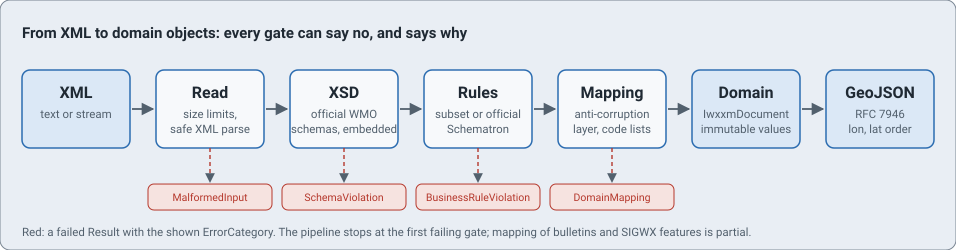
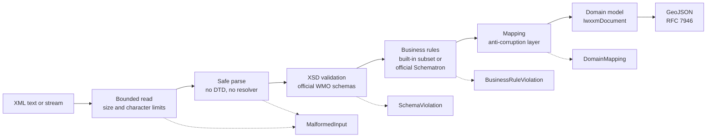
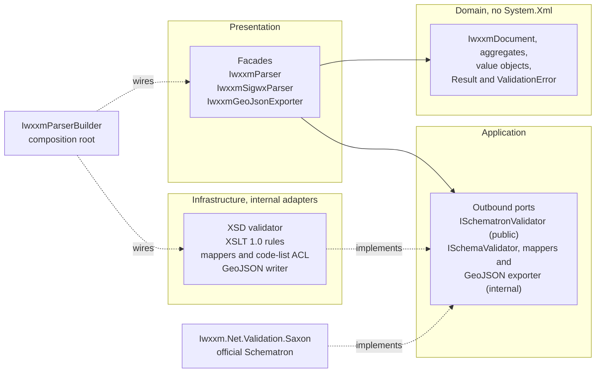
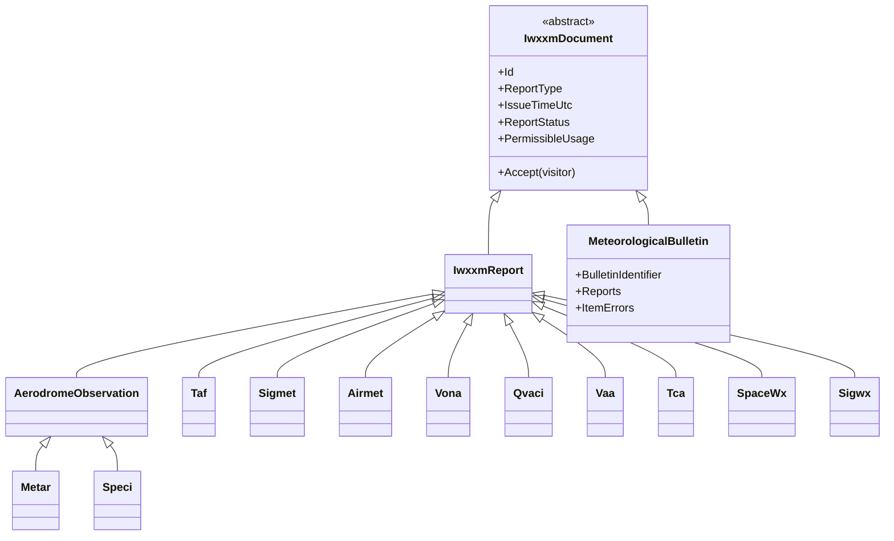
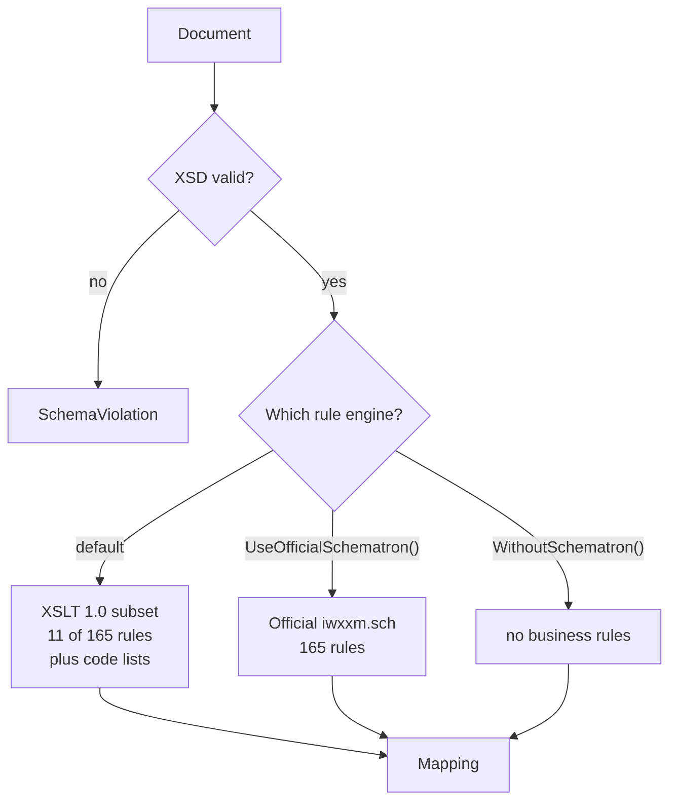
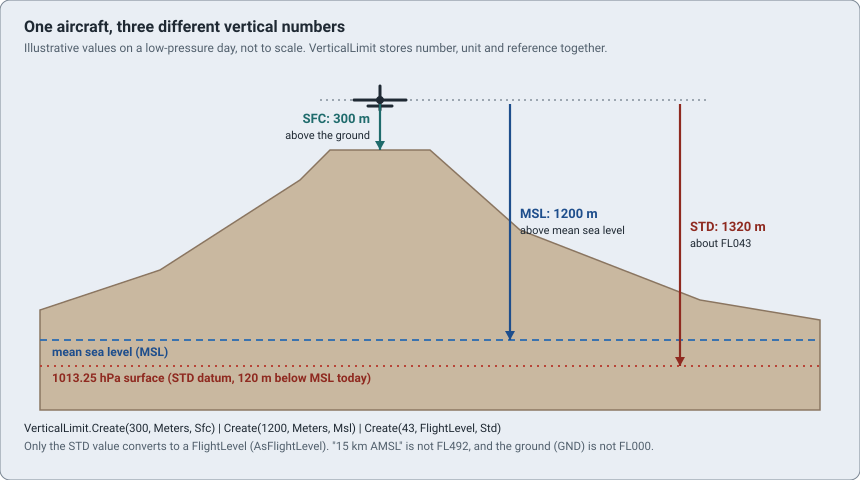
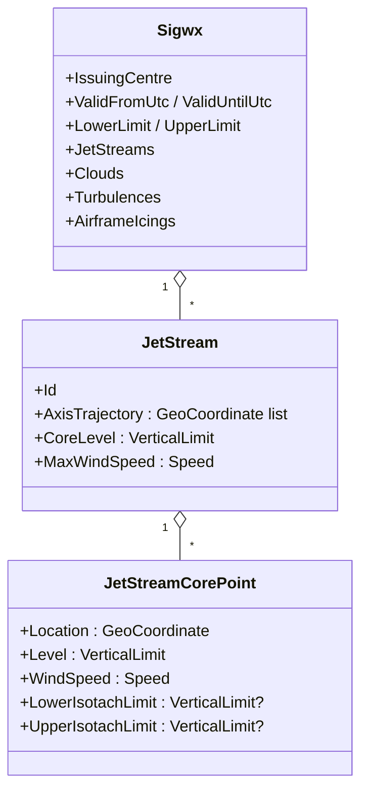
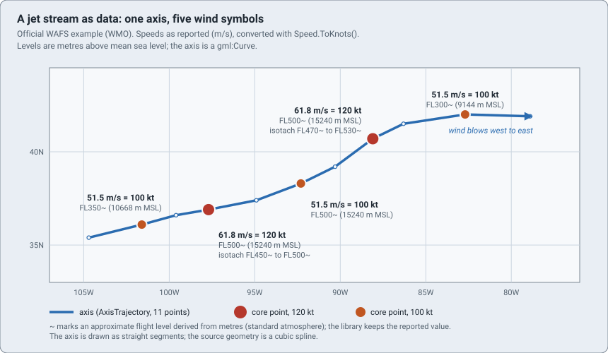
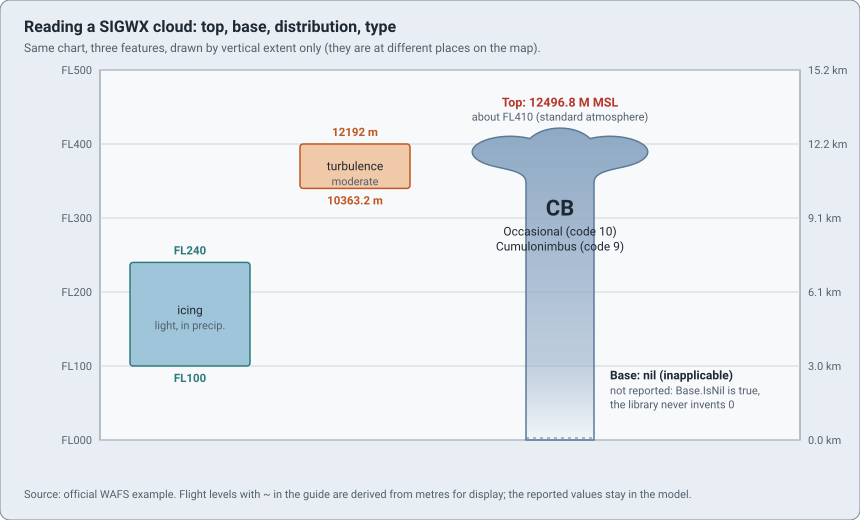

# Getting started with Iwxxm.Net

A guided tour of the library, from "what is this XML?" to reading jet streams and cumulonimbus clouds off an official WAFS chart. Every C# snippet in this guide is compiled against the packaged library, and every `output` block is the real output of that snippet.

**Contents**

1. [Before you start](#1-before-you-start)
2. [What is IWXXM, in plain words](#2-what-is-iwxxm-in-plain-words)
3. [Your first parse](#3-your-first-parse)
4. [Which document did I get?](#4-which-document-did-i-get)
5. [Validation levels](#5-validation-levels)
6. [Options and security limits](#6-options-and-security-limits)
7. [Error-code cheat sheet](#7-error-code-cheat-sheet)
8. [GeoJSON export](#8-geojson-export)
   - [8A. CSV export](#8a-csv-export)
   - [8B. GeoPackage export](#8b-geopackage-export)
9. [Value-object cookbook](#9-value-object-cookbook)
10. [Worked example: jet streams (SIGWX)](#10-worked-example-jet-streams-sigwx)
11. [Worked example: clouds (SIGWX)](#11-worked-example-clouds-sigwx)
12. [Worked example: METAR, SPECI and TAF](#12-worked-example-metar-speci-and-taf)
13. [Worked example: SIGMET](#13-worked-example-sigmet)
14. [Common pitfalls](#14-common-pitfalls)
15. [FAQ](#15-faq)
16. [Where to go next](#16-where-to-go-next)
17. [Further reading and visual references](#17-further-reading-and-visual-references)

---

## 1. Before you start

You need the **.NET 10 SDK** to build this guide's examples (the library itself targets `netstandard2.0` and `netstandard2.1`, so your own application can be much older, down to .NET Framework 4.6.1).

```bash
dotnet new console -n IwxxmTour
cd IwxxmTour
dotnet add package Iwxxm.Net
# only needed for section 5, "official Schematron" (net10.0 applications):
dotnet add package Iwxxm.Net.Validation.Saxon
```

The packages are published on NuGet.org (and mirrored on GitHub Packages); the [README](../README.md#installation) shows the install commands and how to add the NuGet.org source if your environment lacks it.

The examples read the **official WMO example messages** that ship with this repository. Copy them next to your project once:

```bash
mkdir samples
cp <repo>/tests/Iwxxm.Net.Tests/Samples/wmo-examples/*.xml samples/
cp <repo>/tests/Iwxxm.Net.Tests/Samples/sigwx-swh-2025-2.xml samples/
```

All paths below are relative to your project folder (`samples/metar-A3-1.xml`, and so on). Each snippet is self-contained: paste it into `Program.cs` and run `dotnet run`. Snippets that define helper types say so, and later snippets reuse them.

Three conventions you will see everywhere:

- **Nothing is invented.** A value that the message does not carry is `null`; it is never replaced by a "sensible" default.
- **Units travel with their value.** A wind speed is a `Speed` (value and unit), a base height is a `Length` or a `VerticalLimit`.
- **Failures are values.** Parsing returns a `Result<T>`; it does not throw on bad input.

## 2. What is IWXXM, in plain words

Aviation weather used to travel as short, human-readable text codes (`METAR EGLL 301250Z 24015KT 9999 SCT025 12/07 Q1013`). That format, TAC (traditional alphanumeric code), is compact but hard for software to read reliably.

**IWXXM** is the XML replacement, published by WMO and ICAO. It describes the *same* operational products as structured data: every wind speed carries its unit, every height its reference, every phenomenon a code from an official WMO register. Version **2025-2** is the one this library implements.

| Product | In plain words |
| :--- | :--- |
| **METAR** | Routine weather observation at an aerodrome (typically every half hour or hour). |
| **SPECI** | Special observation, issued when conditions change significantly between METARs. |
| **TAF** | Aerodrome forecast: base conditions plus change groups (`BECMG`, `TEMPO`, `FM`). |
| **SIGMET** | Warning of en-route hazards (thunderstorms, turbulence, icing, volcanic ash, tropical cyclones) inside a flight information region (FIR). |
| **AIRMET** | Warning of lower-level hazards for flights below the SIGMET threshold. |
| **VAA** | Volcanic Ash Advisory from a Volcanic Ash Advisory Centre. |
| **TCA** | Tropical Cyclone Advisory from a Tropical Cyclone Advisory Centre. |
| **SpaceWx** | Space Weather Advisory (effects on HF radio, GNSS, radiation levels). |
| **VONA** | Volcano Observatory Notice for Aviation, with an aviation colour code. |
| **QVACI** | Quantitative Volcanic Ash Concentration Information: ash concentration contours. |
| **SIGWX** | WAFS Significant Weather forecast: global high-level "weather chart" data (jet streams, cumulonimbus, turbulence, icing, tropopause, volcanoes, cyclones). |

Messages usually arrive inside a **collective bulletin** (`collect:MeteorologicalBulletin`) that bundles many reports.

### The pipeline

Iwxxm.Net treats every incoming document as untrusted, and walks it through a fixed sequence of gates. Each gate that fails produces a `ValidationError` with a stable `Code` and an `ErrorCategory`.





Dotted arrows are the failure exits; the four categories shown are values of `ErrorCategory`. The fifth, `Deserialization`, covers documents that cannot be routed to a mapper, such as asking for a bulletin (`ParseBulletin...`) when the file holds a single METAR (`DISPATCH-NOT-A-BULLETIN`).

### The layers

The library is a typed read-model parser with a hexagonal-style layering ("ports and adapters"): the domain model knows nothing about XML, and every technology (XSD, Schematron, mapping, GeoJSON) sits behind an outbound port. There are no use-case classes between the facades and the ports: the facades run the pipeline directly. You normally only touch the facades on the left; the one port meant for replacement is `ISchematronValidator`.



The dependency rules across layers are enforced by automated architecture tests (see [CONTRIBUTING.md](../CONTRIBUTING.md#hexagonal-architecture-rules)).

## 3. Your first parse

`IwxxmParser.ParseFile` reads a file, runs the whole pipeline and returns a `Result<IwxxmDocument>`:

```csharp
using System;
using Iwxxm.Net;
using Iwxxm.Net.Reports;

Result<IwxxmDocument> result = IwxxmParser.ParseFile("samples/metar-A3-1.xml");

if (result.IsFailure)
{
    foreach (ValidationError error in result.Errors)
    {
        Console.Error.WriteLine(error);
    }
    return;
}

IwxxmDocument document = result.Value;
Console.WriteLine($"{document.ReportType} issued {document.IssueTimeUtc:u}");
Console.WriteLine($"Status: {document.ReportStatus}, usage: {document.PermissibleUsage}");
Console.WriteLine($"Warnings: {result.Warnings.Count}");
```
```output
Metar issued 2012-08-22 16:30:00Z
Status: Normal, usage: Operational
Warnings: 0
```

Notice three things:

- **`IsFailure` first, `Value` second.** Reading `Value` on a failed result throws `InvalidOperationException`. That is deliberate: it is the one place where ignoring a failure is a programming error.
- **Every report carries its metadata.** `ReportStatus` and `PermissibleUsage` are required by the schema and are never defaulted (a `TEST` or `NON-OPERATIONAL` report must never look operational).
- **Times are UTC.** All `...Utc` properties hold `DateTimeOffset` values with a zero offset.

`Parse(string)`, `Parse(Stream)` and `ParseFile(string)` are the three input shapes; the static members are thin wrappers over `IwxxmParser.Default`. When you need a configured parser, use the instance methods (`Process...`) of a parser built with `IwxxmParserBuilder`, as shown in [section 5](#5-validation-levels).

### Which entry point do I use?

The facade constructors are `internal`, so there are exactly two ways to get a parser:

| You need | Use | Example |
| :--- | :--- | :--- |
| Default limits and the built-in rule subset (the common case) | `IwxxmParser.Default`, or the static `Parse*` helpers, which call it | `IwxxmParser.ParseFile(path)` |
| A WAFS SIGWX chart, a bulletin, or any other report | the same `IwxxmParser`; ask for the type with `ParseAs<T>` / `ParseFileAs<T>` | `IwxxmParser.ParseFileAs<Sigwx>(path)` |
| GeoJSON from a document you already parsed | `IwxxmGeoJsonExporter.Default` and its static helper | `IwxxmGeoJsonExporter.ToGeoJson(document)` |
| Custom limits, the official Schematron, your own rule engine, or no business rules | `IwxxmParserBuilder`, then `Build()` / `BuildGeoJsonExporter()` | `new IwxxmParserBuilder().WithOptions(options).Build()` |

SIGWX needs no entry point of its own. `IwxxmParser` reads the official `iwxxm:WAFSSignificantWeatherForecast`, the compact `iwxxm:SIGWXReport` and bulletins that carry them, and `ParseAs<Sigwx>` gives the typed `Result<Sigwx>`. `IwxxmSigwxParser` is an optional narrow facade over the same mapper: it returns `Result<Sigwx>` directly (no `ParseAs` cast) and refuses any other root element before mapping with `XSD-UNEXPECTED-ROOT-ELEMENT`, bulletins included. Use it only if you want that early refusal; its builder method is `BuildSigwxParser()`.

The builder offers `WithOptions`, `UseSchematronValidator` (an `ISchematronValidator` or a factory), `WithoutSchematron` and, with the Saxon package, `UseOfficialSchematron()`. Build once and reuse the result; parsers are immutable and thread-safe. `ISchematronValidator` and `IwxxmDocumentContext` (namespace `Iwxxm.Net.Extensibility`) are the only public extension points.

### Errors are values

Bad input does not throw. You get a failed `Result<T>` whose errors say which gate refused the document:

```csharp
using System;
using Iwxxm.Net;
using Iwxxm.Net.Reports;

Result<IwxxmDocument>[] attempts =
{
    IwxxmParser.Parse("<not-xml"),                        // not well-formed
    IwxxmParser.Parse("<foo xmlns='urn:example'/>"),      // well-formed, but not an IWXXM root
    IwxxmParser.Parse("   "),                             // nothing to parse
    IwxxmParser.ParseFile("samples/does-not-exist.xml"),  // I/O problem (never read)
};

foreach (Result<IwxxmDocument> attempt in attempts)
{
    ValidationError first = attempt.Errors[0];
    Console.WriteLine($"{first.Category,-16} {first.Code}");
}

// Or branch on the result:
Result<IwxxmDocument> parsed = IwxxmParser.ParseFile("samples/metar-A3-1.xml");
string summary = parsed.IsSuccess
    ? $"parsed a {parsed.Value.ReportType}"
    : $"{parsed.Errors.Count} error(s)";
Console.WriteLine(summary);
```
```output
MalformedInput   XML-MALFORMED
SchemaViolation  XSD-UNKNOWN-ROOT-ELEMENT
MalformedInput   XML-EMPTY-STRING
Io               FILE-NOT-FOUND
parsed a Metar
```

Only *argument* mistakes throw: a `null` stream (`ArgumentNullException`) or a `null`, empty or whitespace file path (`ArgumentException`). A blank *string* of XML is not an argument mistake; it is bad input, and returns `XML-EMPTY-STRING`.

### Warnings and partial results

A successful result can still carry **warnings**. They matter: a warning means "I gave you everything I could, but something was left out". The official WAFS example is a real case: one of its features is given only as a URL to an external resource, which this version does not resolve.

```csharp
using System;
using Iwxxm.Net;
using Iwxxm.Net.Reports;

Result<Sigwx> result = IwxxmParser.ParseFileAs<Sigwx>("samples/WAFS-Example.xml");
Console.WriteLine($"Success: {result.IsSuccess}, warnings: {result.Warnings.Count}");

foreach (ValidationError warning in result.Warnings)
{
    Console.WriteLine($"{warning.Severity}: {warning.Code}");
}

Sigwx chart = result.Value;
foreach (ItemMappingError skipped in chart.FeatureErrors)
{
    Console.WriteLine($"Feature #{skipped.Index} skipped: {skipped.Errors[0].Code}");
}
Console.WriteLine($"Jet streams: {chart.JetStreams.Count}, clouds: {chart.Clouds.Count}, volcanoes: {chart.Volcanoes.Count}");
```
```output
Success: True, warnings: 1
Warning: ACL-SIGWX-FEATURE-BY-REFERENCE
Feature #9 skipped: ACL-SIGWX-FEATURE-BY-REFERENCE
Jet streams: 1, clouds: 1, volcanoes: 1
```

The same rule applies to collective bulletins: one broken report does not discard the other forty ([section 4](#bulletins-many-reports-one-envelope)). Schema and rule validation stay all-or-nothing for the whole document; only *mapping* is partial.

## 4. Which document did I get?

The parser returns the common base type `IwxxmDocument`. It is a **closed hierarchy**: only this library can add subtypes.



`Sigmet` covers three XML roots (`SIGMET`, `VolcanicAshSIGMET`, `TropicalCycloneSIGMET`); `ReportType` tells them apart.

### Pattern matching

The everyday tool is a `switch` over the concrete type:

```csharp
using System;
using Iwxxm.Net;
using Iwxxm.Net.Reports;

foreach (string name in new[] { "metar-A3-1", "taf-A5-1", "sigmet-A6-1b-CNL", "WAFS-Example", "vona-A7-1", "metar-NIL-collect" })
{
    Result<IwxxmDocument> result = IwxxmParser.ParseFile($"samples/{name}.xml");
    if (result.IsFailure)
    {
        Console.WriteLine($"{name}: FAILED {result.Errors[0].Code}");
        continue;
    }

    string line = result.Value switch
    {
        Metar metar => $"METAR {metar.AerodromeDesignator}, QNH {metar.QnhHpa} hPa",
        Speci speci => $"SPECI {speci.AerodromeDesignator}",
        Taf taf => $"TAF {taf.AerodromeDesignator}, {taf.ChangeForecasts.Count} change groups",
        Sigmet sigmet => $"{sigmet.ReportType} {sigmet.FirDesignator} #{sigmet.SequenceNumber}{(sigmet.IsCancelReport ? " (cancellation)" : "")}",
        Sigwx chart => $"SIGWX from {chart.IssuingCentre}, {chart.JetStreams.Count} jet stream(s)",
        Vona vona => $"VONA #{vona.NoticeNumber}, colour code {vona.CurrentColourCode?.Code}",
        MeteorologicalBulletin bulletin => $"Bulletin {bulletin.BulletinIdentifier} with {bulletin.Reports.Count} report(s)",
        IwxxmReport other => $"Other report: {other.ReportType}",
        _ => "Unknown document",
    };
    Console.WriteLine($"{name,-20} -> {line}");
}
```
```output
metar-A3-1           -> METAR YUDO, QNH 1018 hPa
taf-A5-1             -> TAF YUDO, 3 change groups
sigmet-A6-1b-CNL     -> Sigmet YUDD #3 (cancellation)
WAFS-Example         -> SIGWX from London, 1 jet stream(s)
vona-A7-1            -> VONA #2021/4, colour code Yellow
metar-NIL-collect    -> Bulletin A_LAYU31YUDO221630_C_YUDO_20120822163000.xml with 1 report(s)
```

### Asking for one type: `ParseAs<T>`

When a channel carries only one product, ask for it. If the document is something else you get a regular failed result, not an `InvalidCastException`:

```csharp
using System;
using Iwxxm.Net;
using Iwxxm.Net.Reports;

Result<Taf> taf = IwxxmParser.ParseFileAs<Taf>("samples/taf-A5-1.xml");
Console.WriteLine($"TAF ok: {taf.IsSuccess}");

Result<Taf> wrong = IwxxmParser.ParseFileAs<Taf>("samples/metar-A3-1.xml");
Console.WriteLine($"{wrong.Errors[0].Code}: {wrong.Errors[0].Message}");

// A base class works too: AerodromeObservation accepts both METAR and SPECI.
Result<AerodromeObservation> observation = IwxxmParser.ParseFileAs<AerodromeObservation>("samples/speci-A3-2.xml");
Console.WriteLine($"{observation.Value.ReportType} at {observation.Value.AerodromeDesignator}");
```
```output
TAF ok: True
IWXXM-UNEXPECTED-REPORT-TYPE: Expected report aggregate of type 'Taf', but parsed 'Metar' (ReportType: Metar).
Speci at YUDO
```

### The visitor: exhaustive by construction

A `switch` needs a `_` arm, because the C# compiler cannot know the hierarchy is closed. If you want the *compiler* to tell you when a new document type appears, implement `IIwxxmDocumentVisitor<TResult>`: it has one `Visit` overload per concrete type, so a visitor that misses a type does not compile.

```csharp
using Iwxxm.Net.Reports;

public sealed class DescribeVisitor : IIwxxmDocumentVisitor<string>
{
    public string Visit(Metar metar) => $"METAR {metar.AerodromeDesignator}";
    public string Visit(Speci speci) => $"SPECI {speci.AerodromeDesignator}";
    public string Visit(Taf taf) => $"TAF {taf.AerodromeDesignator}";
    public string Visit(Sigmet sigmet) => $"{sigmet.ReportType} {sigmet.FirDesignator}";
    public string Visit(Airmet airmet) => $"AIRMET {airmet.FirDesignator}";
    public string Visit(Vona vona) => $"VONA {vona.NoticeNumber}";
    public string Visit(Qvaci qvaci) => $"QVACI {qvaci.OriginatingCentreName}";
    public string Visit(Vaa vaa) => $"VAA {vaa.AdvisoryNumber}";
    public string Visit(Tca tca) => $"TCA {tca.CycloneName}";
    public string Visit(SpaceWx swx) => $"SWX {swx.AdvisoryNumber}";
    public string Visit(Sigwx sigwx) => $"SIGWX {sigwx.IssuingCentre}";
    public string Visit(MeteorologicalBulletin bulletin) => $"BULLETIN {bulletin.BulletinIdentifier}";
}
```

```csharp
using System;
using Iwxxm.Net;
using Iwxxm.Net.Reports;

IwxxmDocument document = IwxxmParser.ParseFile("samples/va-advisory-A7-2.xml").Value;
Console.WriteLine(document.Accept(new DescribeVisitor()));
```
```output
VAA 2024/4
```

### Bulletins: many reports, one envelope

Operational feeds rarely deliver one report per file. A `MeteorologicalBulletin` exposes the successfully mapped `Reports`, the per-entry `ReportResults`, and the entries that could not be mapped in `ItemErrors`:

```csharp
using System;
using Iwxxm.Net;
using Iwxxm.Net.Reports;

foreach (string name in new[] { "metar-NIL-collect", "taf-NIL-collect", "sigmet-translation-failed-collect" })
{
    Result<MeteorologicalBulletin> result = IwxxmParser.ParseBulletinFile($"samples/{name}.xml");
    if (result.IsFailure)
    {
        Console.WriteLine($"{name}: {result.Errors[0].Code}");
        continue;
    }

    MeteorologicalBulletin bulletin = result.Value;
    Console.WriteLine($"{name}: {bulletin.Reports.Count} mapped of {bulletin.ReportResults.Count}, warnings: {result.Warnings.Count}");
    foreach (IwxxmReport report in bulletin.Reports)
    {
        string detail = report is AerodromeObservation obs
            ? $"NIL observation: {obs.IsNilObservation}"
            : report.IsTranslationFailed ? "translation failed, raw TAC kept" : "";
        Console.WriteLine($"  {report.ReportType} {detail}");
    }
    foreach (ItemMappingError skipped in bulletin.ItemErrors)
    {
        Console.WriteLine($"  skipped entry #{skipped.Index}: {skipped.Errors[0].Code}");
    }
}
```
```output
metar-NIL-collect: 1 mapped of 1, warnings: 0
  Metar NIL observation: True
taf-NIL-collect: 1 mapped of 1, warnings: 0
  Taf
sigmet-translation-failed-collect: 1 mapped of 1, warnings: 0
  Sigmet translation failed, raw TAC kept
```

None of the official samples contains an unmappable entry (the WAFS chart in [section 3](#warnings-and-partial-results) shows the same mechanism for features), but when one does, `ItemErrors` lists its index and `gml:id` and the result carries a matching warning. A bulletin with *no* mappable report fails with `DOMAIN-BULLETIN-EMPTY`. `ParseBulletin...` insists that the root is a bulletin (anything else fails with `DISPATCH-NOT-A-BULLETIN`); `Parse...` accepts either and returns the bulletin as an `IwxxmDocument`.

## 5. Validation levels

By default every document passes **two gates** before mapping: XSD validation against the unmodified official WMO schemas, then *business rules*. The business rules come at two levels:

| Level | Engine | Rules | Package |
| :--- | :--- | :--- | :--- |
| **Default** | XSLT 1.0 (`XslCompiledTransform`) | A subset: 11 of the 165 official rule ids, the official code-list membership checks, plus a few library checks | `Iwxxm.Net` (zero dependencies) |
| **Official** | SaxonCS-HE running the unmodified `iwxxm.sch` | All 165 official rule patterns | `Iwxxm.Net.Validation.Saxon` (`net10.0`) |
| **None** | - | XSD only | `WithoutSchematron()` |



Why two levels? The official `iwxxm.sch` needs XSLT 2.0, which the .NET base library cannot run. Shipping a Schematron engine in the core package would break its "zero dependencies, runs on .NET Framework" promise, so the full rule set lives in an optional package ([FAQ](#15-faq)).

The difference is easy to see. Below, a METAR is edited so that it declares `cloudAndVisibilityOK="true"` (CAVOK) while *still* reporting visibility, RVR and clouds, which the official rule `METAR_SPECI.MeteorologicalAerodromeObservation-1` forbids:

```csharp
using System;
using System.IO;
using Iwxxm.Net;
using Iwxxm.Net.Reports;

string xml = File.ReadAllText("samples/metar-A3-1.xml");

// Flip the first cloudAndVisibilityOK="false" (the observation, not the trend forecasts).
const string original = "cloudAndVisibilityOK=\"false\"";
int at = xml.IndexOf(original, StringComparison.Ordinal);
string contradictory = xml.Substring(0, at) + "cloudAndVisibilityOK=\"true\"" + xml.Substring(at + original.Length);

// 1. Default: the built-in subset does not implement that rule.
Result<IwxxmDocument> byDefault = IwxxmParser.Parse(contradictory);
Console.WriteLine($"Default : success = {byDefault.IsSuccess}");

// 2. Official: all 165 rules, from the optional Iwxxm.Net.Validation.Saxon package.
IwxxmParser official = new IwxxmParserBuilder()
    .UseOfficialSchematron()      // extension method, namespace Iwxxm.Net
    .Build();

Result<IwxxmDocument> strict = official.Process(contradictory);
Console.WriteLine($"Official: success = {strict.IsSuccess}");
foreach (ValidationError error in strict.Errors)
{
    Console.WriteLine($"  {error.Category}: {error.Code}");
    Console.WriteLine($"  {error.Message}");
}

// The untouched file passes both.
Console.WriteLine($"Official, original file: success = {official.ProcessFile("samples/metar-A3-1.xml").IsSuccess}");
```
```output
Default : success = True
Official: success = False
  BusinessRuleViolation: METAR_SPECI.MeteorologicalAerodromeObservation-1
  METAR_SPECI.MeteorologicalAerodromeObservation-1: When cloudAndVisibilityOK is true, visibility, rvr, presentWeather and cloud should be missing
Official, original file: success = True
```

What to choose:

- **Gateways that accept messages from the outside** (SWIM, AMHS, WIS2): use `UseOfficialSchematron()`. Compile it once at start-up with `OfficialSchematronValidator.Warmup()`; the first compilation takes roughly a second, after which the validator is immutable and thread-safe.
- **Readers of trusted, already-validated feeds**: the default is cheaper and dependency-free.
- **Your own engine**: implement `ISchematronValidator` (namespace `Iwxxm.Net.Extensibility`) and plug it in with `UseSchematronValidator(...)`.

Build the parser once and reuse it; the instances are immutable and thread-safe.

## 6. Options and security limits

IWXXM arrives from networks, so the parser enforces limits *before* it allocates or parses. `IwxxmParserOptions` collects them:

| Option | Default | Meaning |
| :--- | :--- | :--- |
| `MaxDocumentBytes` | 50 MiB (52,428,800) | Largest accepted input; larger streams fail with `XML-SIZE-LIMIT`. |
| `MaxCharactersInDocument` | 52,428,800 | Character cap enforced by the `XmlReader` (never lower than the byte limit needs: a character takes at least one byte). |
| `MaxCharactersFromEntities` | 1,024 | Cap on entity expansion. |
| `MaxValidationErrors` | 100 | Findings reported per validator, then a `...-TOO-MANY-ERRORS` sentinel. |
| `MaxRuleReportBytes` | 4 MiB | Size cap of the Schematron SVRL report. |
| `MaxElementDepth` | 128 | Deepest accepted element nesting (root = 1); a deeper document fails with `XML-DEPTH-LIMIT` before any tree is built. Real products need at most about 20; the stack of the .NET tree validation overflows at about 25,000 levels (see [SECURITY.md](../SECURITY.md#element-depth-limit)). |

DTDs are always refused and no external resource is ever resolved; XML bombs and XXE attacks cannot even start.

These limits bound size, nesting and memory; they do not bound CPU time. The library is synchronous and has no time limit or cancellation token, and a hostile but within-limit document can still be slow. When you parse untrusted input, bound it on your side:

- run the parse on a worker (a `Task.Run` or a job queue) that you can abandon after a timeout, so a slow document cannot hold a request thread;
- cap the size before the parser sees it (the 50 MiB default is a ceiling, not a target; lower `MaxDocumentBytes` and `MaxCharactersInDocument` together to what your feeds need);
- limit how many documents are parsed at once: transient allocation is about 46 times the document size for a real SIGWX parse, and [SECURITY.md](../SECURITY.md#memory-cost-of-the-default-size-limit) gives the budget per concurrent request.

```csharp
using System;
using Iwxxm.Net;
using Iwxxm.Net.Reports;

IwxxmParser strict = new IwxxmParserBuilder()
    .WithOptions(new IwxxmParserOptions(maxDocumentBytes: 1024))
    .Build();

Result<IwxxmDocument> tooBig = strict.ProcessFile("samples/metar-A3-1.xml");
Console.WriteLine($"{tooBig.Errors[0].Category}: {tooBig.Errors[0].Code}");
Console.WriteLine(tooBig.Errors[0].Message);

const string billionLaughsStyle = "<!DOCTYPE x [<!ENTITY a \"b\">]><x>&a;</x>";
Result<IwxxmDocument> withDtd = IwxxmParser.Parse(billionLaughsStyle);
Console.WriteLine($"{withDtd.Errors[0].Category}: {withDtd.Errors[0].Code}");
```
```output
MalformedInput: XML-SIZE-LIMIT
The input XML stream length (6854 bytes) exceeds the maximum allowed limit of 1024 bytes.
MalformedInput: XML-MALFORMED
```

`IwxxmParserBuilder` is also where you plug in a custom Schematron engine, drop the business rules (`WithoutSchematron()`), or register the parser in a dependency-injection container. The [reference](REFERENCE.md#composition-root-and-dependency-injection) shows the container wiring.

## 7. Error-code cheat sheet

`ValidationError.Code` is the stable contract; messages may be reworded. Switch on the code (or on `Category`), never on the message text.

| `ErrorCategory` | Typical codes | What happened |
| :--- | :--- | :--- |
| `Io` | `FILE-NOT-FOUND`, `ACCESS-DENIED`, `FILE-READ-ERROR`, `STREAM-UNREADABLE`, `STREAM-READ-ERROR` | The input could not be read at all (missing file, no permission, failing stream). The message was never seen; a retry may succeed. |
| `MalformedInput` | `XML-EMPTY-STRING`, `STREAM-EMPTY`, `XML-SIZE-LIMIT`, `XML-DEPTH-LIMIT`, `XML-MALFORMED`, `XML-NO-ROOT-ELEMENT` | The bytes were read but never became a usable XML document. |
| `SchemaViolation` | `XSD-UNKNOWN-ROOT-ELEMENT`, `XSD-*`, `XSD-TOO-MANY-ERRORS` | Well-formed XML that breaks the official schema. |
| `BusinessRuleViolation` | official rule ids such as `METAR_SPECI.MeteorologicalAerodromeObservation-1`, `SCHEMATRON-UNAVAILABLE`, `SCHEMATRON-REPORT-SIZE-LIMIT` | A Schematron or code-list rule failed. |
| `Deserialization` | `DISPATCH-NOT-A-BULLETIN`, `XML-UNSUPPORTED-ROOT`, `XML-UNSUPPORTED-REPORT`, `XML-DESERIALIZATION-ERROR`, `COLLECT-NESTED-BULLETIN` | Valid document, but of a shape the requested entry point or mapper does not handle. |
| `DomainMapping` | `ACL-*`, `DOMAIN-*`, `IWXXM-UNEXPECTED-REPORT-TYPE`, `GEOJSON-EXPORT-ERROR`, `MAPPER-ERROR` | Valid XML that cannot become a safe domain object (a missing mandatory time, a speed with an unsupported unit, a negative visibility...). |

In code, compare against the constants of `IwxxmErrorCodes` instead of retyping the strings (`error.Code == IwxxmErrorCodes.FileNotFound`); they are `const`, so they also work in `switch` statements. The class lists the codes a caller realistically branches on; the several hundred `ACL-*` and `DOMAIN-*` codes describe document content and are matched by prefix. [The reference](REFERENCE.md#error-codes) lists everything.

A handler that reacts to the category is usually enough:

```csharp
using System;
using Iwxxm.Net;
using Iwxxm.Net.Reports;

foreach (string source in new[] { "<broken", "<foo xmlns='urn:example'/>" })
{
    Result<IwxxmDocument> result = IwxxmParser.Parse(source);
    foreach (ValidationError error in result.Errors)
    {
        string advice = error.Category switch
        {
            ErrorCategory.Io => "retry or fix the environment: the input could not be read",
            ErrorCategory.MalformedInput => "reject the message: the sender sent garbage",
            ErrorCategory.SchemaViolation => "reject the message: it is not valid IWXXM 2025-2",
            ErrorCategory.BusinessRuleViolation => "reject or quarantine: an official rule failed",
            ErrorCategory.Deserialization => "programming or routing error: wrong entry point for this document",
            ErrorCategory.DomainMapping => "log and investigate: valid XML with unusable content",
            _ => "unexpected category",
        };
        Console.WriteLine($"{error.Code,-26} -> {advice}");
    }
}
```
```output
XML-MALFORMED              -> reject the message: the sender sent garbage
XSD-UNKNOWN-ROOT-ELEMENT   -> reject the message: it is not valid IWXXM 2025-2
```

The complete table of codes, with meaning, typical cause and remediation, is in the [reference](REFERENCE.md#error-codes); a test fails if a code emitted by the library is missing from it.

## 8. GeoJSON export

Every document with geometry can be exported as an RFC 7946 `FeatureCollection`: `[longitude, latitude]` coordinates (GML uses latitude first), polygon holes, a `bbox`, antimeridian splitting and circles densified to 64-segment polygons. Measures are written **as reported**, with a sibling `...Uom` property; nothing is converted. Volcano features carry the IAVCEI number (`Volcano.IavceiNumber`) as the property `iavceiNumber`; VONA and QVACI volcanoes also carry `activityStatus` and `sourceElevation` (with `sourceElevationUom`) when reported. QVACI ash clouds carry `ashDensityEqualsOrExceedsMgPerM3`, a lower bound rather than a measured density, and QVACI volcanoes carry `originatingCentreName`.

```csharp
using System;
using System.Linq;
using System.Text.Json;
using Iwxxm.Net;

Result<string> geoJson = IwxxmParser.ParseFileToGeoJson("samples/sigmet-A6-2-TC.xml", GeoJsonExportOptions.Default);
if (geoJson.IsFailure)
{
    Console.WriteLine(geoJson.Errors[0]);
    return;
}

using JsonDocument json = JsonDocument.Parse(geoJson.Value);
JsonElement root = json.RootElement;
Console.WriteLine($"type: {root.GetProperty("type").GetString()}");
Console.WriteLine($"bbox: {root.GetProperty("bbox")}");
Console.WriteLine($"report: {root.GetProperty("metadata").GetProperty("reportType").GetString()}");

foreach (JsonElement feature in root.GetProperty("features").EnumerateArray())
{
    string geometry = feature.GetProperty("geometry").GetProperty("type").GetString()!;
    string kind = feature.GetProperty("properties").GetProperty("featureType").GetString()!;
    Console.WriteLine($"feature: {kind} ({geometry})");
}
```
```output
type: FeatureCollection
bbox: [-77.7752162,22.9361467,-68.4247838,31.2638533]
report: TropicalCycloneSigmet
feature: SIGMET_EVOLVING_VOLUME (Polygon)
feature: TROPICAL_CYCLONE_CENTRE (Point)
feature: TROPICAL_CYCLONE_CENTRE (Point)
```

`System.Text.Json` is in the box on modern .NET; Iwxxm.Net itself has no JSON dependency and returns the GeoJSON as a plain `string` inside a `Result<string>`. If you already hold a parsed document, call `IwxxmGeoJsonExporter.ToGeoJson(document, options)`: it returns a `Result<string>` too (an exporter failure is a `GEOJSON-EXPORT-ERROR` value; only a `null` document throws). `GeoJsonExportOptions.Pretty` indents the output; `Default` is compact.

## 8A. CSV export

`Iwxxm.Net` also writes any document as RFC 4180 CSV: one flat table with the same 26 columns for every report type, for spreadsheets and for tools that read delimited text. Like the GeoJSON export it returns a `Result<string>`; the entry points are `IwxxmParser.ParseFileToCsv` (and the `ParseToCsv` and `ProcessToCsv` family) for XML input and `IwxxmCsvExporter.ToCsv(document, options)` for a document you already hold. An exporter failure is a `CSV-EXPORT-ERROR` value; only a `null` document throws.

```csharp
using System;
using Iwxxm.Net;

Result<string> csv = IwxxmParser.ParseFileToCsv("samples/metar-A3-1.xml");
if (csv.IsFailure)
{
    Console.WriteLine(csv.Errors[0]);
    return;
}

string[] records = csv.Value.Split(new[] { "\r\n" }, StringSplitOptions.RemoveEmptyEntries);
Console.WriteLine($"{records.Length - 1} data row(s)");
Console.WriteLine(records[0]);
Console.WriteLine(records[1]);

Result<string> custom = IwxxmParser.ParseFileToCsv(
    "samples/sigmet-A6-2-TC.xml",
    new CsvExportOptions(delimiter: ";", includeGeometryWkt: false));
Console.WriteLine(custom.Value.Split(new[] { "\r\n" }, StringSplitOptions.None)[2]);
```
```output
1 data row(s)
BulletinId,ReportId,ReportType,FeatureType,FeatureId,ReportStatus,PermissibleUsage,PermissibleUsageReason,IssueTimeUtc,ValidFromUtc,ValidUntilUtc,StationOrCentre,Lat,Lon,GeometryWkt,LowerLimit,UpperLimit,WindDirectionDeg,WindSpeed,WindSpeedUnit,AirTemperatureC,QnhHpa,VisibilityM,Phenomenon,Intensity,Details
,uuid.510df5de-fefb-4406-bafd-faab35333ec0,Metar,METAR_OBSERVATION,uuid.510df5de-fefb-4406-bafd-faab35333ec0,Normal,Operational,,2012-08-22T16:30:00.0000000+00:00,2012-08-22T16:30:00.0000000+00:00,2012-08-22T16:30:00.0000000+00:00,YUDO,12.34,-12.34,POINT (-12.34 12.34),,,240,4,m/s,17,1018,600,DZ FG,,
;uuid.f12194be-0d82-49ad-ad97-41e46f724dec;TropicalCycloneSigmet;TROPICAL_CYCLONE_CENTRE;uuid.c0a23437-9eb7-4e6b-82f2-6fbd5757440c#tc;Normal;Operational;;2012-08-25T16:00:00.0000000+00:00;2012-08-25T16:00:00.0000000+00:00;2012-08-25T22:00:00.0000000+00:00;YUCC;27.100000000000001;-73.099999999999994;;;;;;;;;;TC;;
```

What to know:

- **The columns are fixed and shared by every product**: identifiers (`BulletinId`, `ReportId`, `ReportType`, `FeatureType`, `FeatureId`), metadata (`ReportStatus`, `PermissibleUsage`, `PermissibleUsageReason`, `IssueTimeUtc`, `ValidFromUtc`, `ValidUntilUtc`), the place (`StationOrCentre`, `Lat`, `Lon`, `GeometryWkt`), vertical limits (`LowerLimit`, `UpperLimit`) and a few common measures (`WindDirectionDeg`, `WindSpeed`, `WindSpeedUnit`, `AirTemperatureC`, `QnhHpa`, `VisibilityM`), plus `Phenomenon`, `Intensity` and `Details`. A column that does not apply to a row is empty. The example METAR is one row; the tropical cyclone SIGMET gives three (the evolving volume and two cyclone positions). The columns are not a full dump of the domain model: use the typed objects, or GeoJSON, when you need every property.
- **Measures keep the reported unit**: the METAR wind is `4` with `WindSpeedUnit` `m/s`, not converted to knots. Numbers are written with the invariant culture and enough digits to read back the same double, which is why the cyclone position shows `27.100000000000001`.
- **Geometry** is OGC WKT in `GeometryWkt` (`POINT (lon lat)`, longitude first), with `Lat` and `Lon` for rows that have one position. It is the geometry of the GeoJSON export, so circles are densified polygons. `includeGeometryWkt: false` leaves the column empty but keeps the header, so the layout never changes.
- **Options**: `CsvExportOptions` has the delimiter (default `,`), the header row (default on), the WKT column (default on), formula protection and the line terminator (default CRLF, per RFC 4180).
- **Formula protection is on by default.** A text cell that starts with `=`, `+`, `-`, `@`, a tab or a carriage return is prefixed with a single quote so that a spreadsheet does not run it as a formula. Numeric cells, such as a negative longitude, are never changed. Turn it off with `sanitizeFormulas: false` only if the consumer is not a spreadsheet.
- **In a bulletin** every row carries the `BulletinId` of the envelope; for a standalone report the column is empty.

## 8B. GeoPackage export

A [GeoPackage](https://www.geopackage.org/) (`.gpkg`) is an OGC standard SQLite file that desktop GIS, GDAL and most spatial databases open directly. `Iwxxm.Net.Export.GeoPackage` is an **optional package** that writes any parsed document to one: the same features as the GeoJSON export, in tables, plus the reports and the document metadata. The core package stays dependency-free; this one depends on `Iwxxm.Net` and `Microsoft.Data.Sqlite`, and it is the only package of the family that brings native binaries (see [.NET Framework](#net-framework-and-native-sqlite) and the size note in the [README](../README.md#installation)).

```bash
dotnet add package Iwxxm.Net.Export.GeoPackage
```

The package is not part of a release yet, so it is not on NuGet.org: until a release includes it, build it from source (`dotnet pack src/Iwxxm.Net.Export.GeoPackage`). It reads internals of `Iwxxm.Net` that only the version it was built against makes visible, so it requires `Iwxxm.Net` of the version it ships with and never works with `Iwxxm.Net` 1.0.0; the two packages are released together with the same new version. With another core version an export fails with `GEOPACKAGE-EXPORT-ERROR` and a message that says the versions do not match.

SQLite writes to a file, so the main operation takes a path. The `Result<string>` carries the full path of the file written.

```csharp
using System;
using System.IO;
using Iwxxm.Net;
using Iwxxm.Net.Export.GeoPackage;
using Microsoft.Data.Sqlite;

string path = Path.Combine(Path.GetTempPath(), "sigmet-A6-2-TC.gpkg");

Result<string> written = IwxxmParser.Default.ProcessFileToGeoPackage("samples/sigmet-A6-2-TC.xml", path);
if (written.IsFailure)
{
    Console.WriteLine(written.Errors[0]);
    return;
}

Console.WriteLine($"written: {Path.GetFileName(written.Value)}");

using var connection = new SqliteConnection($"Data Source={path};Mode=ReadOnly;Pooling=False");
connection.Open();
using SqliteCommand command = connection.CreateCommand();

command.CommandText = "SELECT table_name, data_type FROM gpkg_contents ORDER BY table_name";
using (SqliteDataReader reader = command.ExecuteReader())
{
    while (reader.Read())
        Console.WriteLine($"{reader.GetString(0)} ({reader.GetString(1)})");
}

command.CommandText = "SELECT feature_type, report_type, json_extract(properties, '$.phenomenonUri') FROM iwxxm_points";
using (SqliteDataReader reader = command.ExecuteReader())
{
    while (reader.Read())
        Console.WriteLine($"{reader.GetString(0)} | {reader.GetString(1)} | {reader.GetString(2)}");
}
```
```output
written: sigmet-A6-2-TC.gpkg
iwxxm_attributes (attributes)
iwxxm_metadata (attributes)
iwxxm_points (features)
iwxxm_polygons (features)
iwxxm_reports (attributes)
TROPICAL_CYCLONE_CENTRE | TropicalCycloneSigmet | http://codes.wmo.int/49-2/SigWxPhenomena/TC
TROPICAL_CYCLONE_CENTRE | TropicalCycloneSigmet | http://codes.wmo.int/49-2/SigWxPhenomena/TC
```

Reading the file back is not part of the package (the snippet uses `Microsoft.Data.Sqlite`, which your project gets through the package reference); GDAL, QGIS or any SQLite client do the same job.

### The API

| Member | Use |
| :--- | :--- |
| `IwxxmGeoPackageExporter.Default.Export(document, path, options)` | Write a document you already parsed. Returns the full path, or a failure. |
| `IwxxmGeoPackageExporter.ToGeoPackage(document, path, options)` | Static shortcut for the same call. |
| `IwxxmGeoPackageExporter.Default.ExportToBytes(document, options)` and `ToGeoPackageBytes` | The bytes of the file, as a `Result<byte[]>`. SQLite only writes to a file, so this goes through a temporary file that is always deleted. |
| `parser.ProcessFileToGeoPackage(filePath, path, options)`, `ProcessToGeoPackage(stream or xml text, path, options)` | Extension methods of `IwxxmParser` (namespace `Iwxxm.Net`): validate, parse and export in one step with the parser you built. |
| `IwxxmParserGeoPackageExtensions.ParseFileToGeoPackage(...)`, `ParseToGeoPackage(...)` | The same with `IwxxmParser.Default`. They are static members of the extensions class, because an extension method cannot add static members to `IwxxmParser`. |

The parse-and-export members return the parse failure unchanged when the document is bad (nothing is written) and keep the parse warnings on success.

### Options

`GeoPackageExportOptions` has two settings. `GeoPackageExportOptions.Default` is GeoPackage 1.4 with the last-change time taken from the document.

| Setting | Values | Notes |
| :--- | :--- | :--- |
| `Version` | `GeoPackageVersion.Version14` (default), `Version13` | Written as `PRAGMA user_version` (10400 or 10300) and as `geopackage_version` in `iwxxm_metadata`. The tables are the same in both. `default(GeoPackageVersion)` is rejected with an `ArgumentOutOfRangeException`. |
| `LastChangeUtc` | a `DateTimeOffset`, or `null` (default) | The `last_change` of every table in `gpkg_contents`. `null` means the issue time of the document; if the document has none, the Unix epoch (`GeoPackageExportOptions.FallbackLastChangeUtc`). |

```csharp
var options = new GeoPackageExportOptions(GeoPackageVersion.Version13, new DateTimeOffset(2025, 1, 1, 0, 0, 0, TimeSpan.Zero));
```

### Determinism

No value comes from the clock. `last_change` is the option above, rows are written in the order of the GeoJSON features, and the file is built in one transaction. Exporting the same document with the same options twice gives files with the same content (on the same runtime: see the note on negative zero below). The SQLite file header records the version of the SQLite library that wrote the file, so compare the content (schema and rows), not the bytes, across SQLite versions; this is also why the repository's golden tests compare a text dump and not a binary file.

### Errors

An export problem is a value, as for GeoJSON and CSV: a failed `Result<string>` with the code `GEOPACKAGE-EXPORT-ERROR` (`ErrorCategory.DomainMapping`, located at the document id). It covers an empty or invalid path, a directory that does not exist (it is not created), a path that is a directory or cannot be written, and any failure while writing. Only a `null` document (or a `null` parser or stream) throws. The members that read a file (`ProcessFileToGeoPackage`, `ParseFileToGeoPackage`) also throw `ArgumentException` for a `null`, empty or whitespace input file path, as the parser does; the output path is not argument-validated and a bad one is reported as a failed `Result`.

```csharp
using System;
using System.IO;
using Iwxxm.Net;

string missing = Path.Combine(Path.GetTempPath(), "no-such-folder", "out.gpkg");
Result<string> failed = IwxxmParser.Default.ProcessFileToGeoPackage("samples/sigmet-A6-2-TC.xml", missing);

Console.WriteLine(failed.Errors[0].Code);
Console.WriteLine(failed.Errors[0].Category);
```
```output
GEOPACKAGE-EXPORT-ERROR
DomainMapping
```

**The target is never half written.** The database is built under a temporary name in the directory of the target and moved onto it only when it is complete and closed. If the export fails, a file that was already at the path is untouched and no temporary file is left behind. The connections are not pooled, so the file can be deleted or moved as soon as the call returns.

### Limits and things to know

- **Messages can hold host paths.** The message of a `GEOPACKAGE-EXPORT-ERROR` can contain a file path of the machine and the text of an internal exception (it ends with the innermost exception type and message, so that a failure to load the native SQLite can be diagnosed). Log it; do not echo it to a client.
- **`ExportToBytes` uses the shared temporary directory** for a moment. On a multi-user host another user may be able to read that file, so a service should call `Export` with a path in a private directory instead.
- **`OutOfMemoryException` is not converted** to a result, like everywhere in the library.
- **Two exports to the same path are not supported**, at the same time or while another process has the file open. An existing target that has a `-wal` or `-journal` file next to it is in use or needs recovery and is not replaced (the export fails and says so). The swap is retried twice with a short pause when the system refuses it; there is no copy fallback.
- **The path is used as given.** It is not confined to a directory, so never pass untrusted text as the path. A symbolic link at the path is replaced, not written through. On Unix the new file keeps its own mode and owner, not those of the file it replaces.
- **Durability.** The file is complete before it is moved onto the target, but the directory is not flushed to disk: a power failure right after the call can lose the swap.
- **A killed process can leave a hidden `.iwxxm-*.tmp` file** (and a `-journal` next to it) in the directory of the target; nothing sweeps them.
- **Network shares.** The database is built next to the target, so a share without reliable file locking is not supported (a SQLite restriction).
- **Negative zero.** A negative zero in a property is written `-0` on .NET and `0` on .NET Framework and Mono, so the `properties` text of such a value differs between those runtimes (the value objects normalize negative zero, so it is rare in practice); the coordinates in the geometry blobs keep the exact value.

### What is in the file

Every table is in WGS 84 (EPSG:4326, longitude then latitude), the same coordinates as the GeoJSON export, including the antimeridian splitting and polar caps (a `LineString` or `Polygon` is stored as a `MultiLineString` or `MultiPolygon` of one member). Geometries are 2D.

| Table | Kind | Content |
| :--- | :--- | :--- |
| `iwxxm_points` | features (`POINT`) | Features whose geometry is a point. |
| `iwxxm_lines` | features (`MULTILINESTRING`) | Features whose geometry is a line. |
| `iwxxm_polygons` | features (`MULTIPOLYGON`) | Features whose geometry is a polygon (areas, circles as densified polygons, volumes). |
| `iwxxm_attributes` | attributes | Features that have no geometry (for example a nil space weather analysis). Always created, even when empty. |
| `iwxxm_reports` | attributes | One row per report of the document (a bulletin has one per report): its status, its permissible usage with the reason (`TEST`, `EXERCISE`) and the supplementary text when it has them, and its issue time. |
| `iwxxm_metadata` | attributes | Key/value rows: library version, GeoPackage version, source document id and type, report count and, for a bulletin that has a non-blank identifier, that identifier. |

A geometry table with no rows is not created (the file above has points and polygons but no `iwxxm_lines`), so read `gpkg_contents` for the tables a file really has. Every row of the four feature tables has the same fixed columns: `feature_id`, `feature_type`, `report_id`, `report_type`, `bulletin_identifier`, `issue_time_utc` and `properties`.

**`properties` is the GeoJSON `properties` object, as JSON text.** It is the same text, with the same keys in the same order, as the `properties` member of the feature in the [GeoJSON export](#8-geojson-export) (one difference between runtimes: a negative zero is written `-0` on .NET and `0` on .NET Framework and Mono): measures with their `...Uom` companions, vertical limits, codes and so on. The fixed columns repeat a few of those values so that you can filter without parsing JSON; everything else is in `properties` and is read with the JSON functions of your SQL engine (`json_extract` in SQLite and in GDAL's SQLite dialect). The full column list is in the [reference](REFERENCE.md#geopackage-tables-and-columns).

The package does not create one table per feature type with a column for each property: that would need a fixed catalogue of properties across all products, and the JSON column keeps every property without one.

### Open it in QGIS or GDAL

QGIS reads GeoPackages through GDAL: **Layer, Add Layer, Add Vector Layer**, choose the `.gpkg`, and add the geometry tables as layers. The attribute tables open as tables without a map. GDAL reads the `properties` column as a text field. The files were checked with GDAL (`ogrinfo` and GDAL's GeoPackage validator), not with the QGIS application.

```bash
ogrinfo -al -so sigmet-A6-2-TC.gpkg                              # layers, feature counts, extents
ogrinfo -dialect SQLite -sql "SELECT feature_type, json_extract(properties, '$.firDesignator') AS fir FROM iwxxm_points" sigmet-A6-2-TC.gpkg
ogr2ogr -f GeoJSON polygons.geojson sigmet-A6-2-TC.gpkg iwxxm_polygons
```

### .NET Framework and native SQLite

The package targets `netstandard2.0`, so it is meant to run from .NET Framework 4.6.1 to .NET 10. SQLite itself is native code, which `Microsoft.Data.Sqlite` brings as `e_sqlite3` binaries under `runtimes/<rid>/native/`. On .NET 10 nothing needs to be done: the library finds the file for the current platform and no initialization call is needed (run here on Linux with glibc and with musl; the Windows and macOS binaries come from the same package and are expected to load the same way, which has not been run). On .NET Framework the loader needs a little more care.

**Status.** The `net48` behaviour below follows from the layout of the NuGet packages and is expected to work. It has been run only under Mono on Linux (the `net48-test` container stage of this repository, which needed a `dllmap` for `libdl` on a current distribution) and not yet on the real .NET Framework on Windows, because the Windows CI job that would do that is delivered as a workflow patch that is not applied yet. Treat the list as the expected requirements, not as a tested result.

- **Use a project that restores with `PackageReference`.** The build targets of the SQLitePCLRaw native package copy `e_sqlite3.dll` for `win-x86` and `win-x64` to `runtimes\win-x86\native\` and `runtimes\win-x64\native\` under your output folder, and the SQLite loader looks there (and next to the executable). Keep those folders when you deploy.
- **A `packages.config` project gets no native file.** The targets are not applied, so copy `e_sqlite3.dll` (from the NuGet cache `runtimes\win-x86\native` or `win-x64\native`, matching your process) next to the executable by hand, or migrate the project to `PackageReference`.
- **Match the process architecture.** The loader is expected to pick `win-x86` or `win-x64` from the running process. Set the platform target to `x86` or `x64`, or leave `AnyCPU` and know which one will run: an `AnyCPU` application with **Prefer 32-bit** runs as x86 even on a 64-bit Windows, and the same application without it runs as x64. Both native files are copied, so either works as long as the process and the file agree; do not copy only one of them by hand and then change the platform target.
- **Windows on ARM64 with .NET Framework is not supported**: the native package has no copy rule for `win-arm64`.
- **Mono on Linux**: the same loader looks in `runtimes/<rid>/native/`; on a current distribution Mono also needs the name `libdl` to resolve (a symlink to `libdl.so.2`, or a `dllmap`), otherwise the load fails with `Library e_sqlite3 not found`.

The package is about 19 MB on restore (95% of it the native SQLite for every platform). A framework-dependent .NET publish copies all of the `runtimes/` folders into the output (34 MB for a small console application in a measurement made for this package); a publish for one runtime identifier is expected to keep only that platform, which has not been tested here.

### The dependency version limit

The package pins `Microsoft.Data.Sqlite` to **10.0.15**. Every 10.0.x release ships a `netstandard2.0` asset; 11.0 targets `net10.0` only and moves to SQLitePCLRaw 3. While the package targets `netstandard2.0` (which is what keeps .NET Framework usable) it stays on the 10.0.x line, and servicing updates of that line change the SQLite version that writes the files. Moving to 11.x means dropping `netstandard2.0` for this package.

### What is not included

- **No spatial index (R-tree).** Without one, a client that filters a large table by extent reads every row. GeoPackage makes the index optional; a reader can build its own, and `ogr2ogr` creates one by default when it copies a layer.
- **No typed per-feature tables.** One table per geometry kind with the properties in a JSON column, not one table per feature type with a column per property.
- **No ring-validity check.** The coordinates and rings are those of the GeoJSON export, copied as they are. The package rejects a geometry it cannot encode (a position that is not finite, a ring that is not closed), but it does not test polygon validity in the sense of GEOS (self-intersections, holes outside the shell) on what it writes.
- **No `gpkg_extensions` rows, triggers or `gpkg_ogr_contents`**: none is required for plain feature and attribute tables.
- **Tiles, rasters and the `gpkg_metadata` tables** are not written.

## 9. Value-object cookbook

The domain is made of small immutable values. They share three habits: they keep **what was reported** (value, unit, reference), they have **exact structural equality**, and they never convert behind your back. This section is a short tour with quick recipes.

### Speed and Length: why units are not in property names

A wind speed in a METAR may be `m/s` or `[kn_i]` depending on the country. If the property were called `WindSpeedKnots`, the library would have to convert silently (and lose what was reported). Instead `Speed` and `Length` keep the amount and the unit together (`Amount` and `Unit`; the property is not called `Value`, so that `Speed?.Value.Amount` stays readable), and *you* choose when to convert:

```csharp
using System;
using Iwxxm.Net.Reports;

var wind = new Speed(10, SpeedUnit.Knots);
Console.WriteLine($"{wind} = {wind.ToMetersPerSecond():F2} m/s = {wind.ToKilometersPerHour():F1} km/h");
Console.WriteLine($"Amount as reported: {wind.Amount} {wind.Unit}, UCUM code {wind.UnitOfMeasure}");

// Equality is about what was reported, not about physics.
var sameWindInMetres = new Speed(wind.ToMetersPerSecond(), SpeedUnit.MetersPerSecond);
Console.WriteLine($"== ? {wind == sameWindInMetres}");
Console.WriteLine($"same magnitude ? {Math.Abs(wind.ToKnots() - sameWindInMetres.ToKnots()) < 1e-9}");

var cloudBase = new Length(2000, LengthUnit.Feet);
Console.WriteLine($"{cloudBase} = {cloudBase.ToMeters():F1} m");
Console.WriteLine($"1 NM = {new Length(1, LengthUnit.NauticalMiles).ToMeters()} m");
```
```output
10 [kn_i] = 5.14 m/s = 18.5 km/h
Amount as reported: 10 Knots, UCUM code [kn_i]
== ? False
same magnitude ? True
2000 [ft_i] = 609.6 m
1 NM = 1852 m
```

Quantities with a *single* legal unit (`AirTemperatureCelsius`, `QnhHpa`, `PrevailingVisibilityMeters`) do keep the unit in the property name, and the mapper rejects any other unit with `ACL-MEASURE-UOM-MISMATCH`.

### VerticalLimit: FL, MSL and SFC are different things

"FL390", "12 000 m above mean sea level" and "300 m above the ground" are not the same kind of number. `VerticalLimit` keeps amount, unit **and reference** and refuses to pretend otherwise.



```csharp
using System;
using Iwxxm.Net.Reports;

VerticalLimit fl390 = VerticalLimit.Create(390, VerticalUnit.FlightLevel, VerticalReference.Std).Value;
VerticalLimit fl250 = VerticalLimit.Create(250, VerticalUnit.FlightLevel, VerticalReference.Std).Value;
VerticalLimit km15 = VerticalLimit.Create(15, VerticalUnit.Kilometers, VerticalReference.Msl).Value;
VerticalLimit ground = VerticalLimit.FromSpecialValue(VerticalSpecialValue.Ground, VerticalReference.Sfc);
VerticalLimit absent = VerticalLimit.Nil(new CodeListValue<NilReason>(NilReason.Inapplicable, "inapplicable"));

Console.WriteLine($"{fl390} | {km15} | {ground} | {absent}");

// A flight level is a derived view, available only for pressure altitudes (STD).
Console.WriteLine($"fl390.AsFlightLevel() = {fl390.AsFlightLevel()}");
Console.WriteLine($"km15.AsFlightLevel()  = {km15.AsFlightLevel()?.ToString() ?? "null (15 km AMSL is not FL492)"}");

// Ordering is only offered when it is meaningful.
Console.WriteLine($"FL250 vs FL390 comparable: {fl250.TryCompareTo(fl390, out int order)}, order = {order}");
Console.WriteLine($"FL390 vs 15 km MSL comparable: {fl390.TryCompareTo(km15, out _)}");
Console.WriteLine($"ground vs 15 km MSL comparable: {ground.TryCompareTo(km15, out _)}");
```
```output
FL390 STD | 15 km MSL | GND SFC | NIL(inapplicable)
fl390.AsFlightLevel() = FL390
km15.AsFlightLevel()  = null (15 km AMSL is not FL492)
FL250 vs FL390 comparable: True, order = -1
FL390 vs 15 km MSL comparable: False
ground vs 15 km MSL comparable: False
```

### GeoSurface: polygon or circle

Areas are a closed union of `GeoPolygon` and `GeoCircle`. A tropical-cyclone SIGMET says "within 250 NM of the centre" with a circle; a thunderstorm area is a polygon. There are two ways to handle both cases. `Match` takes one handler per case, so the compiler makes you supply both: a pair of functions returning a value, or a pair of actions for statements. Pattern matching on the public sealed subtypes `GeoPolygon` and `GeoCircle` reads naturally too, but the compiler does not check that every case is covered.

```csharp
using System;
using System.Linq;
using Iwxxm.Net.Reports;

GeoCoordinate Point(double lat, double lon) => GeoCoordinate.Create(lat, lon).Value;

GeoSurface polygon = GeoPolygon.Create(new[] { Point(40, -10), Point(40, 0), Point(45, 0), Point(45, -10) }).Value;
GeoSurface circle = GeoCircle.Create(Point(27.1, -73.1), new Length(250, LengthUnit.NauticalMiles)).Value;

foreach (GeoSurface area in new[] { polygon, circle })
{
    string text = area.Match(
        p => $"polygon with {p.ExteriorRing.Count} ring points (closed automatically)",
        c => $"circle around {c.Centre}, radius {c.Radius} = {c.Radius.ToKilometers():F0} km");
    Console.WriteLine(text);
}

// Statements instead of values: the overload that takes two actions.
polygon.Match(
    p => Console.WriteLine($"action overload: polygon, {p.ExteriorRing.Count} ring points"),
    c => Console.WriteLine("action overload: circle"));

// The same with pattern matching on the public sealed subtypes:
switch (circle)
{
    case GeoPolygon p2:
        Console.WriteLine($"first = last ? {p2.ExteriorRing.First() == p2.ExteriorRing.Last()}");
        break;
    case GeoCircle c2:
        Console.WriteLine($"switch: circle, radius {c2.Radius.Amount} {c2.Radius.UnitOfMeasure}");
        break;
}
```
```output
polygon with 5 ring points (closed automatically)
circle around (27.1000, -73.1000), radius 250 [nmi_i] = 463 km
action overload: polygon, 5 ring points
switch: circle, radius 250 [nmi_i]
```

A `GeoCoordinate` rejects latitudes outside [-90, 90] and longitudes outside [-180, 180]; polygon holes live in `GeoPolygon.InteriorRings`.

### Code lists: `CodeListValue<T>`

Fields such as cloud amount, SIGMET phenomenon or colour code are references into official WMO registers. The library translates each into an enum (`Code`) and keeps the code as reported (`Notation`). A known code maps to its member and `Notation` is the code. Anything else (a code that is not in the official list for IWXXM 2025-2, a foreign URI, a bare token) is **never dropped**: it becomes `Unknown` and `Notation` is the reference as written.

```csharp
using System;
using Iwxxm.Net;
using Iwxxm.Net.Reports;

Metar metar = IwxxmParser.ParseFileAs<Metar>("samples/metar-A3-1.xml").Value;
foreach (AerodromeCloudLayer layer in metar.CloudLayers)
{
    CodeListValue<AerodromeCloudAmount>? amount = layer.Amount;
    Console.WriteLine($"{amount?.Code} (notation {amount?.Notation}), known: {amount?.IsKnown}");
}

// Unknown codes survive:
var strange = new CodeListValue<AerodromeCloudAmount>(AerodromeCloudAmount.Unknown, "XYZ");
Console.WriteLine($"{strange}  -> IsKnown = {strange.IsKnown}");

// Present weather is a code list too, with its own tiny wrapper:
foreach (AerodromeWeather weather in metar.PresentWeather)
{
    Console.WriteLine($"weather {weather.Notation}, official: {weather.IsKnown}");
}
```
```output
Scattered (notation SCT), known: True
Overcast (notation OVC), known: True
Unknown (XYZ)  -> IsKnown = False
weather DZ, official: True
weather FG, official: True
```

### Nil reasons: "nothing" is information

In IWXXM an absent value can come with a *reason*, and the reason is operationally important. `NSC` ("no significant cloud") is not the same as `NCD` ("no cloud detected by the automatic system") and neither is the same as "the cloud group is missing". These reasons are `CodeListValue<NilReason>`, with convenience flags where they matter. Every nil reason of the model has this type: the cloud, weather and vertical-visibility reasons, the reason of a nil METAR/SPECI `observation` (`ObservationNilReason`) or TAF `baseForecast` (`BaseForecastNilReason`), of a nil space weather `intensityAndRegion` (`SpaceWeatherAnalysis.NilReason`) and of a nil `VerticalLimit` (`NilReason`). A known code maps to its member (`Notation` = the code); any other reason (an unlisted register code, a foreign URI, a bare token such as `unknown`) is never dropped: `Code` is `Unknown` and `Notation` holds the reference as written; no warning is added. The official SPECI example has a trend forecast that says "no significant weather, no significant cloud":

```csharp
using System;
using Iwxxm.Net;
using Iwxxm.Net.Reports;

Speci speci = IwxxmParser.ParseFileAs<Speci>("samples/speci-A3-2.xml").Value;
foreach (AerodromeForecastGroup trend in speci.TrendForecasts)
{
    Console.WriteLine($"Trend {trend.ChangeIndicator}:");
    Console.WriteLine($"  NSW (no significant weather) : {trend.IsNoSignificantWeather}");
    if (trend.Cloud is null)
    {
        Console.WriteLine("  cloud                        : not mentioned in this trend");
        continue;
    }
    Console.WriteLine($"  cloud nil reason             : {trend.Cloud.NilReason}");
    Console.WriteLine($"  NSC (no significant cloud)   : {trend.Cloud.IsNoSignificantCloud}");
    Console.WriteLine($"  NCD (no cloud detected)      : {trend.Cloud.IsNoCloudDetected}");
    Console.WriteLine($"  cloud layers reported        : {trend.CloudLayers.Count}");
}
```
```output
Trend TEMPORARY_FLUCTUATIONS:
  NSW (no significant weather) : False
  cloud                        : not mentioned in this trend
Trend BECOMING:
  NSW (no significant weather) : True
  cloud nil reason             : NothingOfOperationalSignificance (nothingOfOperationalSignificance)
  NSC (no significant cloud)   : True
  NCD (no cloud detected)      : False
  cloud layers reported        : 0
```

### Time indicators

SIGMET and AIRMET volumes, and space-weather analyses, say whether a phenomenon is **observed** (`OBS`) or **forecast** (`FCST`) at a given time. That is `TimeIndicator` (`Observation` / `Forecast`), next to `PhenomenonTimeUtc`. METAR trends and TAF change groups use `TrendTimeIndicator` (`At`, `Until`, `From`) and a `ChangeIndicator` string. Both appear in the worked examples below.

## 10. Worked example: jet streams (SIGWX)

### The weather first

A **jet stream** is a narrow, fast river of air high in the atmosphere (airliners cruise right in it), blowing roughly west to east and meandering with the boundary between warm and cold air masses. A tailwind of 120 knots saves fuel; a headwind costs it; strong wind shear on its edges makes bumps.

WAFS significant-weather charts show a jet stream as:

- an **axis**: a line (here a smooth spline) following the core of the wind;
- **core points** (wind symbols) along the axis with the wind speed at that point and the level of the maximum wind;
- optionally an **isotach layer** at each point: the vertical slab, between a lower and an upper level, where the wind stays strong around that core.

ICAO charts draw jet streams whose maximum wind is at least **80 knots**; the library enforces that (`DOMAIN-JETSTREAM-SPEED`). The model, seen from the code:



The official WAFS example holds one jet stream over the central United States: an 11-point axis and five wind symbols, with speeds in **m/s** and heights in **metres above mean sea level**. Here it is, drawn from the very coordinates in the file:



### A helper for levels

Core levels are `15240 M MSL`, not `FL500`. The library will not guess; to *display* or *filter* by flight level you convert deliberately. Put this helper in a file of its own (`Levels.cs`); the following examples use it.

```csharp
using System;
using Iwxxm.Net.Reports;

public static class Levels
{
    private const double FeetPerMeter = 1 / 0.3048;

    /// Approximate height in feet, only for sorting and filtering on a chart-like display.
    /// It treats a pressure altitude and an altitude above MSL as the same thing, which is
    /// true only in the standard atmosphere. Never use it for an operational decision.
    public static double? ApproxFeet(VerticalLimit? limit)
    {
        if (limit is not { } l || l.IsNil || l.Amount is not { } value)
        {
            return null;
        }

        return l.Unit switch
        {
            VerticalUnit.FlightLevel => value * 100,
            VerticalUnit.Feet => value,
            VerticalUnit.Meters => value * FeetPerMeter,
            VerticalUnit.Kilometers => value * 1000 * FeetPerMeter,
            _ => null,
        };
    }

    /// "FL410~ (12496.8 M MSL)": the approximation first, the reported value always.
    public static string Format(VerticalLimit? limit)
    {
        if (limit is not { } l)
        {
            return "not reported";
        }

        if (l.IsNil)
        {
            // The reason is a URL such as http://codes.wmo.int/iwxxm/nil/inapplicable; keep its last segment.
            return "nil: " + (l.NilReason?.Notation ?? "no reason").Split('/')[^1];
        }

        return ApproxFeet(l) is { } feet ? $"FL{feet / 100:000}~ ({l})" : l.ToString();
    }
}
```

### Reading the jet stream

```csharp
using System;
using System.Linq;
using Iwxxm.Net;
using Iwxxm.Net.Reports;

Sigwx chart = IwxxmParser.ParseFileAs<Sigwx>("samples/WAFS-Example.xml").Value;
Console.WriteLine($"{chart.IssuingCentre}, valid {chart.ValidFromUtc:u} to {chart.ValidUntilUtc:u}");
Console.WriteLine($"Chart envelope: {chart.LowerLimit} to {chart.UpperLimit}");

foreach (JetStream jet in chart.JetStreams)
{
    Console.WriteLine();
    Console.WriteLine($"Jet stream, axis of {jet.AxisTrajectory.Count} points, maximum wind {jet.MaxWindSpeed} = {jet.MaxWindSpeed.ToKnots():F0} kt");
    Console.WriteLine($"Level of the maximum: {Levels.Format(jet.CoreLevel)}");
    Console.WriteLine();
    Console.WriteLine("  lat    lon      level                         wind (reported)  kt   isotach layer");

    foreach (JetStreamCorePoint point in jet.CorePoints)
    {
        string layer = point.LowerIsotachLimit is { } low && point.UpperIsotachLimit is { } high
            ? $"{Levels.ApproxFeet(low) / 100:F0}..{Levels.ApproxFeet(high) / 100:F0} (FL, approx.)"
            : "-";
        Console.WriteLine($"{point.Location.Lat,6:F1} {point.Location.Lon,7:F1}  {Levels.Format(point.Level),-29} {point.WindSpeed,-16} {point.WindSpeed.ToKnots(),3:F0}  {layer}");
    }
}
```
```output
London, valid 2001-01-31 00:00:00Z to 2001-02-01 18:00:00Z
Chart envelope: FL100 STD to FL600 STD

Jet stream, axis of 11 points, maximum wind 61.8 m/s = 120 kt
Level of the maximum: FL500~ (15240 M MSL)

  lat    lon      level                         wind (reported)  kt   isotach layer
  36.1  -101.6  FL350~ (10668 M MSL)          51.5 m/s         100  -
  36.9   -97.7  FL500~ (15240 M MSL)          61.8 m/s         120  450..500 (FL, approx.)
  38.3   -92.3  FL500~ (15240 M MSL)          51.5 m/s         100  -
  40.7   -88.1  FL500~ (15240 M MSL)          61.8 m/s         120  470..530 (FL, approx.)
  42.0   -82.7  FL300~ (9144 M MSL)           51.5 m/s         100  -
```

How to read the table:

- `51.5 m/s` is the wind **as the centre reported it**. The `kt` column converts it with `ToKnots()` (1 kt = 1852/3600 m/s): 51.5 m/s is about 100 kt, 61.8 m/s about 120 kt.
- `15240 M MSL` is a height above mean sea level. Divided by 0.3048 it is 50 000 ft, which the `FL500~` prefix shows. The `~` is a reminder that this is an approximation for display; the exact reported value stays in parentheses.
- The two core points with an isotach layer say the strong wind is not a thin line: around the core at 36.9 N the 120 kt air spans roughly FL450 to FL500.
- In the [GeoJSON export](#8-geojson-export) (and so in the GeoPackage `properties` column) a core point with an isotach layer has `lowerIsotachLevel` and `upperIsotachLevel` after `windSpeedUom`, each with `...Uom` and `...Reference` like `level`; a point without one has no such key. The CSV export does not include them.

### Filtering and finding things

Because `Speed` and `VerticalLimit` are values, filters read naturally. "Which wind symbols are at or above FL450 and faster than 110 kt?", "where is the strongest wind?":

```csharp
using System;
using System.Linq;
using Iwxxm.Net;
using Iwxxm.Net.Reports;

Sigwx chart = IwxxmParser.ParseFileAs<Sigwx>("samples/WAFS-Example.xml").Value;
JetStream jet = chart.JetStreams.Single();

var fast = jet.CorePoints
    .Where(p => Levels.ApproxFeet(p.Level) >= 45_000 && p.WindSpeed.ToKnots() > 110)
    .OrderByDescending(p => p.WindSpeed.ToKnots());

foreach (JetStreamCorePoint p in fast)
{
    Console.WriteLine($"{p.Location}: {p.WindSpeed.ToKnots():F0} kt at {Levels.Format(p.Level)}");
}

JetStreamCorePoint strongest = jet.CorePoints.MaxBy(p => p.WindSpeed.ToKnots())!;
Console.WriteLine($"Strongest wind symbol: {strongest.WindSpeed} at {strongest.Location}");

GeoCoordinate start = jet.AxisTrajectory.First();
GeoCoordinate end = jet.AxisTrajectory.Last();
Console.WriteLine($"Axis runs from {start} to {end} ({jet.AxisTrajectory.Count} points)");
```
```output
(36.9000, -97.7000): 120 kt at FL500~ (15240 M MSL)
(40.7000, -88.1000): 120 kt at FL500~ (15240 M MSL)
Strongest wind symbol: 61.8 m/s at (36.9000, -97.7000)
Axis runs from (35.4000, -104.7000) to (41.9000, -78.9000) (11 points)
```

The compact sample (`sigwx-swh-2025-2.xml`) has the same concept in a different dress: a root `iwxxm:SIGWXReport`, which is a **library-specific compact format**, not an official IWXXM element. The same `Sigwx` model comes out, with speeds in knots and levels in true flight levels:

```csharp
using System;
using Iwxxm.Net;
using Iwxxm.Net.Reports;

Sigwx chart = IwxxmParser.ParseFileAs<Sigwx>("samples/sigwx-swh-2025-2.xml").Value;
JetStream jet = chart.JetStreams[0];

Console.WriteLine($"{chart.IssuingCentre}: {chart.LowerLimit} to {chart.UpperLimit}");
Console.WriteLine($"Maximum wind {jet.MaxWindSpeed} at {jet.CoreLevel}");
Console.WriteLine($"As flight level: {jet.CoreLevel.AsFlightLevel()?.ToString() ?? "null"}");
```
```output
EGRR: FL250 to FL630
Maximum wind 135 [kn_i] at FL360
As flight level: null
```

Note that `AsFlightLevel()` returns `null` here even though the value is `FL360`: the compact format does not report a vertical reference, and the library refuses to assume `STD`. See [pitfalls](#14-common-pitfalls).

## 11. Worked example: clouds (SIGWX)

### The weather first

On a SIGWX chart the clouds that matter are **cumulonimbus (CB)**: tall thunderstorm clouds whose tops can reach the stratosphere, with turbulence, icing, hail and lightning inside. Each CB feature is an area (a polygon) with a **base** and a **top**, a **distribution** (how much of the area is covered) and a **type**.



Distribution words, as ICAO defines them for CB:

| Code | Meaning | Library value (`CloudDistributionCode`) |
| :--- | :--- | :--- |
| **ISOL** | Isolated: individual CBs, covering less than half of the area | `Isolated` (8) |
| **OCNL** | Occasional: well-separated CBs, covering 50 to 75 percent | `Occasional` (10) |
| **FRQ** | Frequent: CBs with little or no separation, covering more than 75 percent | `Frequent` (12) |
| **EMBD** | Embedded: hidden in other cloud layers or haze, so a pilot cannot see around them | `Embedded` (16) |

The combinations exist too: `IsolatedEmbedded` (9), `OccasionalEmbedded` (11) and `FrequentEmbedded` (17). `Notation` keeps the code as it appeared in the message (the numeric code `10` in the standard format, `OCNL_EMBD` in the compact one).

The standard WAFS example has one CB area around Florida, Cuba and the Bahamas. Its **base is nil** ("inapplicable"): the chart does not give a base at all, and the library says so instead of inventing `0`.

### Reading the clouds

```csharp
using System;
using Iwxxm.Net;
using Iwxxm.Net.Reports;

Sigwx chart = IwxxmParser.ParseFileAs<Sigwx>("samples/WAFS-Example.xml").Value;

foreach (Cloud cloud in chart.Clouds)
{
    Console.WriteLine($"Cloud area {cloud.Id}");
    Console.WriteLine($"  distribution : {cloud.Distribution?.Code} (code {cloud.Distribution?.Notation})");
    Console.WriteLine($"  type         : {cloud.CloudType?.Code} (code {cloud.CloudType?.Notation})");
    Console.WriteLine($"  base         : {Levels.Format(cloud.Base)}");
    Console.WriteLine($"  top          : {Levels.Format(cloud.Top)}");
    Console.WriteLine($"  is a CB?     : {cloud.CloudType?.Code == CloudTypeCode.Cumulonimbus}");

    string shape = cloud.Area.Match(
        polygon => $"polygon, {polygon.ExteriorRing.Count - 1} vertices",
        circle => $"circle, radius {circle.Radius}");
    Console.WriteLine($"  area         : {shape}");
    Console.WriteLine($"  patches      : {cloud.Areas.Count}");
}
```
```output
Cloud area uuid.6f770e58-488b-4d89-b828-4c952b7d6a65
  distribution : Occasional (code 10)
  type         : Cumulonimbus (code 9)
  base         : nil: inapplicable
  top          : FL410~ (12496.8 M MSL)
  is a CB?     : True
  area         : polygon, 8 vertices
  patches      : 1
```

`Base` is `VerticalLimit?` and here it is a **nil limit** (`IsNil` is true and `NilReason` holds the reason as a `CodeListValue<NilReason>`, here `Unknown` with the foreign URI `http://codes.wmo.int/iwxxm/nil/inapplicable` kept in `Notation`; `ToString()` prints it as `NIL(...)`). It is `null` only when the element is missing altogether. `Top` is mandatory. When `Base` is a number, the library checks that `Top` is above it (`DOMAIN-CLOUD-VERTICAL-EXTENT`).

### Turbulence and icing: separate features

Clouds do not carry turbulence or icing properties. In IWXXM, turbulence and airframe icing are **their own features** with their own areas, vertical extent and degree, and a chart may overlay them. The degree codes do have "in cloud" members (`ModerateInCloud`, `LightInCloud`...) that tell you the hazard is cloud-related. Listing all hazard layers of the chart together:

```csharp
using System;
using System.Collections.Generic;
using Iwxxm.Net;
using Iwxxm.Net.Reports;

Sigwx chart = IwxxmParser.ParseFileAs<Sigwx>("samples/WAFS-Example.xml").Value;

var rows = new List<(string Kind, string What, VerticalLimit? Base, VerticalLimit Top)>();
foreach (Cloud c in chart.Clouds)
    rows.Add(("CLOUD", $"{c.Distribution?.Code} {c.CloudType?.Code}", c.Base, c.Top));
foreach (Turbulence t in chart.Turbulences)
    rows.Add(("TURBULENCE", t.Degree?.Code.ToString() ?? "?", t.Base, t.Top));
foreach (AirframeIcing i in chart.AirframeIcings)
    rows.Add(("ICING", i.Degree?.Code.ToString() ?? "?", i.Base, i.Top));

Console.WriteLine($"{"kind",-11} {"what",-26} {"base",-26} top");
foreach (var row in rows)
{
    Console.WriteLine($"{row.Kind,-11} {row.What,-26} {Levels.Format(row.Base),-26} {Levels.Format(row.Top)}");
}
```
```output
kind        what                       base                       top
CLOUD       Occasional Cumulonimbus    nil: inapplicable          FL410~ (12496.8 M MSL)
TURBULENCE  Moderate                   FL340~ (10363.2 M MSL)     FL400~ (12192 M MSL)
ICING       LightInPrecipitation       FL100~ (FL100 MSL)         FL240~ (FL240 MSL)
```

Two lessons are hiding in that table:

1. The **turbulence** layer is in metres (`10363.2 M MSL` to `12192 M MSL`), the **icing** layer in flight levels (`FL100` to `FL240`) and the **cloud** in metres with a nil base. Each says what it says; `Levels` makes them comparable for *display*.
2. The icing layer is `FL100 MSL`: a flight level whose reference is MSL, which is odd (flight levels are pressure altitudes, referenced to STD). The library reports it exactly as the message states, and `AsFlightLevel()` returns `null` for it.

### Filter by flight level

"Which hazards could I meet at FL350?" A feature crosses a level when its base is at or below it and its top at or above it. A missing or nil base is treated here as "not bounded below", a documented assumption of this example:

```csharp
using System;
using System.Linq;
using Iwxxm.Net;
using Iwxxm.Net.Reports;

Sigwx chart = IwxxmParser.ParseFileAs<Sigwx>("samples/WAFS-Example.xml").Value;

foreach (int level in new[] { 200, 350, 450 })
{
    var hits = chart.Clouds.Where(c => Crosses(c.Base, c.Top, level)).Select(_ => "CB cloud")
        .Concat(chart.Turbulences.Where(t => Crosses(t.Base, t.Top, level)).Select(t => $"turbulence ({t.Degree?.Code})"))
        .Concat(chart.AirframeIcings.Where(i => Crosses(i.Base, i.Top, level)).Select(i => $"icing ({i.Degree?.Code})"));
    Console.WriteLine($"FL{level}: {string.Join(", ", hits.DefaultIfEmpty("nothing on this chart"))}");
}

static bool Crosses(VerticalLimit? lower, VerticalLimit upper, int flightLevel)
{
    double feet = flightLevel * 100;
    double? top = Levels.ApproxFeet(upper);
    double? bottom = Levels.ApproxFeet(lower);   // null when nil or not reported: unbounded below
    return top >= feet && (bottom is null || bottom <= feet);
}
```
```output
FL200: CB cloud, icing (LightInPrecipitation)
FL350: CB cloud, turbulence (Moderate)
FL450: nothing on this chart
```

### The compact sample and the codes

The compact `SIGWXReport` carries the same cloud in TAC words (`OCNL_EMBD`, `CB`) with flight levels. Same model, same code, different `Notation`:

```csharp
using System;
using Iwxxm.Net;
using Iwxxm.Net.Reports;

Sigwx chart = IwxxmParser.ParseFileAs<Sigwx>("samples/sigwx-swh-2025-2.xml").Value;
Cloud cb = chart.Clouds[0];

Console.WriteLine($"distribution: {cb.Distribution}");   // Code (Notation)
Console.WriteLine($"type        : {cb.CloudType}");
Console.WriteLine($"layer       : {cb.Base} to {cb.Top}");
Console.WriteLine($"embedded?   : {cb.Distribution?.Code is CloudDistributionCode.Embedded or CloudDistributionCode.OccasionalEmbedded or CloudDistributionCode.IsolatedEmbedded or CloudDistributionCode.FrequentEmbedded}");

if (cb.Area is GeoPolygon area)
{
    Console.WriteLine($"area        : polygon, {area.ExteriorRing.Count - 1} vertices, first {area.ExteriorRing[0]}");
}
```
```output
distribution: OccasionalEmbedded (OCNL_EMBD)
type        : Cumulonimbus (CB)
layer       : FL250 to FL420
embedded?   : True
area        : polygon, 4 vertices, first (43.0000, -9.0000)
```

### Export the clouds to GeoJSON

A GIS tool wants polygons, not C# objects. Export the chart and keep only the cloud features; the properties carry the codes (name and number) and the reported vertical limits with their units:

```csharp
using System;
using System.Linq;
using System.Text.Json;
using Iwxxm.Net;

Result<string> geoJson = IwxxmParser.ParseFileToGeoJson("samples/WAFS-Example.xml");
using JsonDocument json = JsonDocument.Parse(geoJson.Value);

var clouds = json.RootElement.GetProperty("features").EnumerateArray()
    .Where(f => f.GetProperty("properties").GetProperty("featureType").GetString() == "CLOUD");

foreach (JsonElement feature in clouds)
{
    JsonElement props = feature.GetProperty("properties");
    JsonElement ring = feature.GetProperty("geometry").GetProperty("coordinates")[0];
    Console.WriteLine($"geometry : {feature.GetProperty("geometry").GetProperty("type").GetString()}, {ring.GetArrayLength()} positions");
    Console.WriteLine($"first    : {ring[0]}   (longitude, latitude)");
    Console.WriteLine($"codes    : {props.GetProperty("distributionCode").GetString()} ({props.GetProperty("distributionNumericCode")}), {props.GetProperty("typeCode").GetString()} ({props.GetProperty("typeNumericCode")})");
    Console.WriteLine($"top      : {props.GetProperty("top")} {props.GetProperty("topUom").GetString()} {props.GetProperty("topReference").GetString()}");
    Console.WriteLine($"base     : nil reason {props.GetProperty("baseNilReason").GetString()}");
}
```
```output
geometry : Polygon, 9 positions
first    : [-84.7,26.7]   (longitude, latitude)
codes    : Occasional (10), Cumulonimbus (9)
top      : 12496.8 M MSL
base     : nil reason http://codes.wmo.int/iwxxm/nil/inapplicable
```

Notice that the coordinates are `[longitude, latitude]`, the opposite of the GML order in the source file (`26.7 -84.7` is latitude 26.7, longitude -84.7).

## 12. Worked example: METAR, SPECI and TAF

### Wind with units, clouds with bases

```csharp
using System;
using Iwxxm.Net;
using Iwxxm.Net.Reports;

Metar metar = IwxxmParser.ParseFileAs<Metar>("samples/metar-A3-1.xml").Value;

Console.WriteLine($"{metar.AerodromeDesignator} ({metar.AerodromeName}) at {metar.ObservationTimeUtc:u}");
Console.WriteLine($"Automated station: {metar.IsAutomatedStation}, CAVOK: {metar.CloudAndVisibilityOk}");
Console.WriteLine($"Temperature {metar.AirTemperatureCelsius} C, dew point {metar.DewpointTemperatureCelsius} C, QNH {metar.QnhHpa} hPa");
Console.WriteLine($"Visibility {metar.PrevailingVisibilityMeters} m");

if (metar.SurfaceWind is { } wind)
{
    Console.WriteLine($"Wind {wind.MeanDirectionDegrees} degrees at {wind.MeanSpeed} (as reported)");
    Console.WriteLine($"  = {wind.MeanSpeed?.ToKnots():F1} kt = {wind.MeanSpeed?.ToMetersPerSecond():F1} m/s; gust: {wind.GustSpeed?.ToString() ?? "none"}");
}

foreach (AerodromeCloudLayer layer in metar.CloudLayers)
{
    Console.WriteLine($"Cloud {layer.Amount?.Notation} base {layer.Base} = {layer.Base?.ToMeters():F0} m, type {layer.CloudType?.Code.ToString() ?? "-"}");
}
foreach (AerodromeWeather weather in metar.PresentWeather)
{
    Console.WriteLine($"Weather {weather.Notation}");
}
```
```output
YUDO (DONLON/INTERNATIONAL) at 2012-08-22 16:30:00Z
Automated station: False, CAVOK: False
Temperature 17 C, dew point 16 C, QNH 1018 hPa
Visibility 600 m
Wind 240 degrees at 4 m/s (as reported)
  = 7.8 kt = 4.0 m/s; gust: none
Cloud SCT base 1000 [ft_i] = 305 m, type -
Cloud OVC base 2000 [ft_i] = 610 m, type -
Weather DZ
Weather FG
```

The wind arrived in `m/s`. A US station would have sent `[kn_i]` and the same code would print knots. That is the whole point of keeping the unit: you never have to wonder which one you are holding.

Cloud layers exist only when the message lists them. Each layer's **amount**, **base** and **type** can individually be missing, and `AmountNilReason`, `BaseNilReason` and `NilReason` say why. At the group level `AerodromeCloud.IsNoSignificantCloud` (`NSC`) and `IsNoCloudDetected` (`NCD`) are the answers to "why is the layer list empty?" (see the [nil-reason recipe](#nil-reasons-nothing-is-information)).

### A TAF: base forecast, change groups, TX and TN

A TAF has a **base forecast** valid for the whole period, followed by **change groups**: `BECOMING` (a gradual change), `TEMPORARY_FLUCTUATIONS` (TEMPO) and `FROM` (FM).

None of the official TAF examples carries forecast maximum and minimum temperatures (TX and TN), so the example below adds them to the base forecast in memory, to show where they land:

```csharp
using System;
using System.IO;
using System.Linq;
using Iwxxm.Net;
using Iwxxm.Net.Reports;

string xml = File.ReadAllText("samples/taf-A5-1.xml");

// Insert <iwxxm:temperature> after the base forecast's cloud (the first forecast in the document).
const string temperatures = @"
            <iwxxm:temperature>
                <iwxxm:AerodromeAirTemperatureForecast>
                    <iwxxm:maximumAirTemperature uom=""Cel"">24.0</iwxxm:maximumAirTemperature>
                    <iwxxm:maximumAirTemperatureTime><gml:TimeInstant gml:id=""tx-1""><gml:timePosition>2012-08-16T12:00:00Z</gml:timePosition></gml:TimeInstant></iwxxm:maximumAirTemperatureTime>
                    <iwxxm:minimumAirTemperature uom=""Cel"">12.0</iwxxm:minimumAirTemperature>
                    <iwxxm:minimumAirTemperatureTime><gml:TimeInstant gml:id=""tn-1""><gml:timePosition>2012-08-16T03:00:00Z</gml:timePosition></gml:TimeInstant></iwxxm:minimumAirTemperatureTime>
                </iwxxm:AerodromeAirTemperatureForecast>
            </iwxxm:temperature>
";
int at = xml.IndexOf("</iwxxm:MeteorologicalAerodromeForecast>", StringComparison.Ordinal);
Taf taf = IwxxmParser.ParseAs<Taf>(xml.Insert(at, temperatures)).Value;

Console.WriteLine($"TAF {taf.AerodromeDesignator}, valid {taf.ValidFromUtc:u} to {taf.ValidUntilUtc:u}");

AerodromeForecastGroup baseForecast = taf.BaseForecast!;
Console.WriteLine($"Base: visibility {baseForecast.PrevailingVisibilityMeters} m, wind {baseForecast.SurfaceWind?.MeanDirectionDegrees} degrees at {baseForecast.SurfaceWind?.MeanSpeed}");
foreach (AerodromeTemperatureForecast t in baseForecast.Temperatures)
{
    Console.WriteLine($"  TX {t.MaximumCelsius} C at {t.MaximumTimeUtc:HH:mm}Z, TN {t.MinimumCelsius} C at {t.MinimumTimeUtc:HH:mm}Z");
}

foreach (AerodromeForecastGroup change in taf.ChangeForecasts)
{
    string weather = string.Join("+", change.Weather.Select(item => item.Notation));
    string visibility = change.PrevailingVisibilityMeters is { } v ? $"{change.PrevailingVisibilityOperator} {v} m".Trim() : "unchanged";
    string wind = change.SurfaceWind is { } w
        ? $"{w.MeanDirectionDegrees}/{w.MeanSpeed}{(w.GustSpeed is { } g ? $" gust {g}" : "")}"
        : "unchanged";
    Console.WriteLine($"{change.ChangeIndicator,-24} {change.ValidFromUtc:HH:mm}-{change.ValidUntilUtc:HH:mm}Z  vis {visibility}, wind {wind}, weather {(weather == "" ? "-" : weather)}");
    foreach (AerodromeCloudLayer layer in change.CloudLayers)
    {
        Console.WriteLine($"{"",-24}   cloud {layer.Amount?.Notation} {layer.Base}{(layer.CloudType is { } t ? " " + t.Notation : "")}");
    }
}
```
```output
TAF YUDO, valid 2012-08-16 00:00:00Z to 2012-08-16 18:00:00Z
Base: visibility 9000 m, wind 130 degrees at 5 m/s
  TX 24 C at 12:00Z, TN 12 C at 03:00Z
BECOMING                 06:00-08:00Z  vis unchanged, wind unchanged, weather -
                           cloud SCT 1500 [ft_i] CB
                           cloud BKN 2000 [ft_i]
TEMPORARY_FLUCTUATIONS   08:00-12:00Z  vis 1000 m, wind 170/6 m/s gust 12 m/s, weather TSRA
                           cloud SCT 1000 [ft_i] CB
                           cloud BKN 2000 [ft_i]
FROM                     12:30-18:00Z  vis Above 10000 m, wind 150/4 m/s, weather -
                           cloud BKN 2000 [ft_i]
```

Things worth noticing: `ChangeIndicator` keeps the IWXXM word (`TEMPORARY_FLUCTUATIONS`, not `TEMPO`); `PrevailingVisibilityOperator` is `Above` when the visibility is "10 km or more" (TAC `9999`); a `TEMPO` with `CB` in the cloud type is the thunderstorm the weather group `TSRA` announced. A group that has no visibility or wind simply inherits the base values, as in the TAC; `null` means "not stated here", never "zero".

Other TAF shapes are modelled as well: a cancellation (`IsCancelReport`, with the `CancelledReportValidFromUtc` and `...UntilUtc` of the TAF being cancelled) and a NIL forecast (`IsNilForecast`, `BaseForecastNilReason`, a `CodeListValue<NilReason>`, usually `Missing`).

## 13. Worked example: SIGMET

A SIGMET warns pilots about a hazard in a **flight information region**. In the model, the hazard is described by **volumes**: an `EnRoutePhenomenonVolume` holds an area (polygon or circle), lower and upper vertical limits, motion, and a time. `EvolvingConditions` are the current or analysed volumes; `ForecastPositions` are where the phenomenon is expected at the end of the validity.

```csharp
using System;
using Iwxxm.Net;
using Iwxxm.Net.Reports;

foreach (string name in new[] { "sigmet-A6-1a-TS", "sigmet-A6-2-TC", "sigmet-VA-EGGX" })
{
    Sigmet sigmet = IwxxmParser.ParseFileAs<Sigmet>($"samples/{name}.xml").Value;

    Console.WriteLine($"{sigmet.ReportType} {sigmet.FirDesignator} ({sigmet.FirName}), #{sigmet.SequenceNumber}");
    Console.WriteLine($"  valid {sigmet.ValidFromUtc:u} to {sigmet.ValidUntilUtc:u}");
    Console.WriteLine($"  phenomenon {sigmet.Phenomenon?.Code} ({sigmet.Phenomenon?.Notation}), MWO {sigmet.MwoDesignator}");

    foreach (EnRoutePhenomenonVolume volume in sigmet.EvolvingConditions)
    {
        string area = volume.Area switch
        {
            GeoCircle circle => $"circle around {circle.Centre}, radius {circle.Radius}",
            GeoPolygon polygon => $"polygon of {polygon.ExteriorRing.Count - 1} vertices",
            _ => "no area",
        };
        Console.WriteLine($"  {volume.TimeIndicator?.ToString() ?? "-"}: {area}");
        Console.WriteLine($"    vertical: {volume.LowerLimit?.ToString() ?? "(no lower limit given)"} to {volume.UpperLimit}");
        if (volume.SpeedOfMotion is { } speed)
        {
            Console.WriteLine($"    moving {volume.DirectionOfMotionDegrees} degrees at {speed} ({speed.ToKnots():F0} kt), intensity {volume.IntensityChange}");
        }
    }
    Console.WriteLine($"  forecast positions: {sigmet.ForecastPositions.Count}");
}
```
```output
Sigmet YUDD (SHANLON FIR/UIR), #2
  valid 2012-08-10 12:00:00Z to 2012-08-10 16:00:00Z
  phenomenon ObscuredThunderstorm (OBSC_TS), MWO YUSO
  Forecast: polygon of 4 vertices
    vertical: (no lower limit given) to FL390 STD
    moving 90 degrees at 20 [kn_i] (20 kt), intensity Weaken
  forecast positions: 0
TropicalCycloneSigmet YUCC (AMSWELL FIR), #3
  valid 2012-08-25 16:00:00Z to 2012-08-25 22:00:00Z
  phenomenon TropicalCyclone (TC), MWO YUDO
  Observation: circle around (27.1000, -73.1000), radius 250 [nmi_i]
    vertical: (no lower limit given) to FL500 STD
  forecast positions: 1
VolcanicAshSigmet EGGX (SHANWICK OCEANIC FIR), #4
  valid 2018-07-25 16:00:00Z to 2018-07-25 22:00:00Z
  phenomenon VolcanicAsh (VA), MWO EGRR
  Observation: polygon of 3 vertices
    vertical: GND SFC to FL550 STD
  forecast positions: 1
```

Reading that:

- The **tropical-cyclone** SIGMET (`TropicalCycloneSigmet`) uses a **circle**: "within 250 nautical miles of the centre". `Radius` is a `Length` with the unit as reported; `GeoCircle` is a first-class citizen, not an approximated polygon (the GeoJSON exporter is the only place where it becomes a 64-segment polygon).
- `GND SFC` is a *ground* lower limit with a surface reference; in the thunderstorm SIGMET the lower limit is simply not stated, and the library reports `null`, not `FL000`.
- `TimeIndicator` says whether the volume is an observation (`OBS`) or a forecast (`FCST`).

### Cancellation

A SIGMET that cancels another one is flagged and carries the identity of what it cancels. It never describes an active hazard:

```csharp
using System;
using Iwxxm.Net;
using Iwxxm.Net.Reports;

Sigmet cancel = IwxxmParser.ParseFileAs<Sigmet>("samples/sigmet-A6-1b-CNL.xml").Value;

Console.WriteLine($"SIGMET #{cancel.SequenceNumber} for {cancel.FirDesignator}: cancellation = {cancel.IsCancelReport}");
if (cancel.IsCancelReport)
{
    Console.WriteLine($"  cancels #{cancel.CancelledReportSequenceNumber}, which was valid {cancel.CancelledReportValidFromUtc:u} to {cancel.CancelledReportValidUntilUtc:u}");
}
Console.WriteLine($"  phenomenon: {(cancel.Phenomenon is null ? "none (a cancellation has no hazard)" : cancel.Phenomenon.ToString())}");
Console.WriteLine($"  volumes: {cancel.EvolvingConditions.Count}");
```
```output
SIGMET #3 for YUDD: cancellation = True
  cancels #2, which was valid 2012-08-10 12:00:00Z to 2012-08-10 16:00:00Z
  phenomenon: none (a cancellation has no hazard)
  volumes: 0
```

The same pattern exists for `Airmet` (`IsCancelReport`, `CancelledReportSequenceNumber`) and `Taf`. Always test `IsCancelReport` before treating a report as a hazard.

## 14. Common pitfalls

1. **Reading `Value` before checking.** `result.Value` on a failure throws. Check `IsSuccess`, or use `TryGetValue`, `Match` or `Map`.
2. **Ignoring warnings.** A successful result may have *left something out* (a SIGWX feature given only by reference, a bulletin entry that could not be mapped). Look at `Warnings`, `Sigwx.FeatureErrors` and `MeteorologicalBulletin.ItemErrors` if completeness matters.
3. **Assuming knots (or metres, or feet).** Read `.Unit`, or convert explicitly with `ToKnots()`, `ToMeters()` and friends.
4. **Treating anything measured in `FL` as a flight level.** `VerticalLimit.AsFlightLevel()` answers only for `STD` references (or exact hundreds of feet under `STD`). A value of `FL100` with an `MSL` or no reference gives `null`, on purpose.
5. **Converting metres to flight levels without saying so.** `15240 M MSL` is about FL500 in the standard atmosphere, nothing more. Keep the original next to any approximation you display (as `Levels.Format` does).
6. **Comparing speeds across units with `==`.** `Speed` equality is exact on amount *and* unit. Compare magnitudes through a common unit.
7. **Expecting cloud bases to be numbers.** `Cloud.Base` may be `null`, a nil limit or a number. Check `IsNil`, `Amount` and `SpecialValue`.
8. **Looking for turbulence and icing inside `Cloud`.** They are separate features (`Sigwx.Turbulences`, `Sigwx.AirframeIcings`).
9. **Treating default validation as certification.** The default rule set is a subset (11 of 165 official rules). Use `UseOfficialSchematron()` when you must reject non-conformant messages.
10. **Forgetting that `Saxon` is `net10.0` only.** The core library runs from .NET Framework 4.6.1; the official-rules package needs .NET 10.
11. **Culture-sensitive output.** Interpolated doubles use the current culture (`10,5` in Spain). Pass `CultureInfo.InvariantCulture` when you write machine-readable text.
12. **Assuming a cancellation is a hazard.** Test `IsCancelReport` on `Sigmet`, `Airmet` and `Taf`.
13. **Building a parser per message.** Schemas and rules are compiled lazily and cached for the process; the parsers are immutable and thread-safe. Reuse `IwxxmParser.Default` or a single built instance.

## 15. FAQ

**Why `Result<T>` instead of exceptions?**
Input from a network is *expected* to be bad sometimes. A malformed message is not an exceptional event for a gateway; it is Tuesday. A result type makes the failure path visible in the signature, carries several structured errors (not just the first), and allows warnings next to a success. Only programmer mistakes (a null stream) throw.

**Why is Schematron in a separate package?**
The official rules need an XSLT 2.0+ processor. The core library is dependency-free and targets `netstandard2.0`, so it can run on .NET Framework; it can only ship an XSLT 1.0 subset. Full coverage uses SaxonCS-HE (MPL-2.0), which brings its own dependencies and needs .NET 10, so it is opt-in through `Iwxxm.Net.Validation.Saxon`.

**Why is the GeoPackage export a separate package?**
It needs SQLite, which is native code with its own packages and licences (about 19 MB on restore). Keeping it in `Iwxxm.Net.Export.GeoPackage` leaves the core with no dependencies, and an application that only parses or writes GeoJSON never downloads SQLite. CSV and GeoJSON need nothing outside the core and stay in it.

**Why `null` instead of sensible defaults?**
In aeronautical meteorology, a default is a lie that looks like data. A report without a status must not become `NORMAL`; a SIGMET without a lower limit must not become `FL000`; a missing wind unit must not become knots. `null` (and nullable reference types) make the compiler remind you that the information may be absent.

**What does "closed hierarchy" mean?**
Every abstract type (`IwxxmDocument`, `IwxxmReport`, `GeoSurface`...) has a constructor that only this assembly can call. You can `switch` over the known subtypes, and the visitor interface lists them all. New document types arrive only with a library release, which is what lets `Accept(visitor)` be exhaustive.

**Is the library thread-safe?**
Yes. The facades, the options and the compiled schemas and rules are immutable or lazily initialised in a thread-safe way. Share them.

**Can I replace a component (XSD validator, mapper, GeoJSON writer, rules)?**
Only the business rules: implement the public `ISchematronValidator` port in `Iwxxm.Net.Extensibility` and plug it in with `UseSchematronValidator(...)`. The schema validator, mappers and GeoJSON exporter are internal. See the [reference](REFERENCE.md#composition-root-and-dependency-injection).

**Does it do network I/O?**
Never. Schemas, code lists and rules are embedded resources, and every external URI is refused.

## 16. Where to go next

- [REFERENCE.md](REFERENCE.md): one example per product family (VAA, TCA, SpaceWx, QVACI, AIRMET...), the full error-code table, the GeoPackage table layout, value-object and namespace reference.
- [README.md](../README.md): installation, status and packaging.
- [CONTRIBUTING.md](../CONTRIBUTING.md): build, tests, golden masters and the architecture rules.
- [CHANGELOG.md](../CHANGELOG.md): what changed between versions.

## 17. Further reading and visual references

No third-party image is stored in this repository. The pictures below are loaded from their original servers; the links go to the pages that carry the authorship and licence.

**Pictures**

[](https://commons.wikimedia.org/wiki/File:NNVL_-_US_Jet_Stream_2012-03-02.png)

*A model map of wind speed at 500 mb (about 18,000 ft) showing the jet stream over the United States. NOAA Storm Prediction Center / NNVL, public domain, via [Wikimedia Commons](https://commons.wikimedia.org/wiki/File:NNVL_-_US_Jet_Stream_2012-03-02.png).*

[](https://commons.wikimedia.org/wiki/File:Four_Cumulonimbus_Incus.jpg)

*Four cumulonimbus (with anvils) in a row. Peter Broster, [CC0 1.0](https://creativecommons.org/publicdomain/zero/1.0/deed.en), via [Wikimedia Commons](https://commons.wikimedia.org/wiki/File:Four_Cumulonimbus_Incus.jpg).*

More images, linked rather than shown:

- [Jet Stream diagram (SVG)](https://commons.wikimedia.org/wiki/File:Jet_Stream_diagram.svg): schematic of the jet stream, by Fred the Oyster, CC BY-SA 4.0.
- [Cumulonimbus incus cloud](https://commons.wikimedia.org/wiki/File:Cumulonimbus_incus_cloud.jpg): a CB with a shelf cloud at the base, by Bidgee, CC BY 3.0.
- [Jet stream convergence](https://commons.wikimedia.org/wiki/File:Jet_Stream_Convergence.jpg): a space-shuttle photograph of clouds along a jet stream, NASA, public domain.

**Weather background**

- [NOAA JetStream: The Jet Stream](https://www.noaa.gov/jetstream/global/jet-stream): an introduction to jet streams from the US National Weather Service.
- [NOAA JetStream: The Basic Ten clouds](https://www.noaa.gov/jetstream/clouds/ten-basic-clouds): includes cumulonimbus.
- [NOAA Aviation Weather Center](https://aviationweather.gov/): operational US aviation weather products.
- [Wikipedia: Jet stream](https://en.wikipedia.org/wiki/Jet_stream) and [Cumulonimbus cloud](https://en.wikipedia.org/wiki/Cumulonimbus_cloud).

**Standards and registers**

- [WMO IWXXM schemas, all versions](https://schemas.wmo.int/iwxxm/) and the [2025-2 schemas](https://schemas.wmo.int/iwxxm/2025-2/).
- [wmo-im/iwxxm on GitHub](https://github.com/wmo-im/iwxxm): the official schemas, Schematron rules and examples used by this library's tests.
- [WMO code registry](https://codes.wmo.int/): the code lists behind `CodeListValue<T>`.
- [RFC 7946, The GeoJSON Format](https://datatracker.ietf.org/doc/html/rfc7946).
- [UCUM](https://ucum.org/ucum): the unit codes (`m/s`, `[kn_i]`, `[ft_i]`) that IWXXM uses.
- [Schematron](https://schematron.com/): the rule language behind `iwxxm.sch`.
